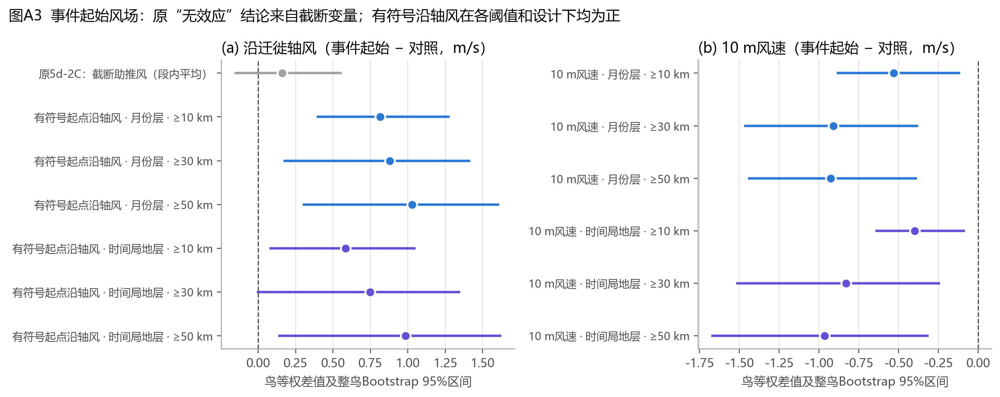
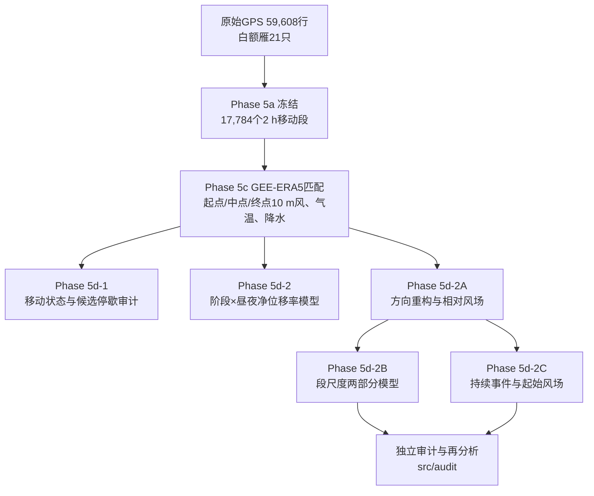

# white-bird：白额雁春迁昼夜移动策略与风场响应

基于GPS追踪与ERA5再分析数据，研究白额雁（*Anser albifrons*）在东亚迁徙路线（鄱阳湖越冬地 → 东北平原停歇区 → 东西伯利亚）春迁期间的昼夜移动策略，以及风场如何调节长距离移动的发生与出发。

> **当前状态：** 阶段性探索分析已完成，独立审计已完成，尚未投稿。请先阅读
> **[项目理解与审计报告](docs/项目理解与审计报告.md)**（[Word版](docs/项目理解与审计报告.docx)）。

## 主要发现（截至2026-11-09）

| 结论 | 证据强度 |
|---|---|
| 春迁与越冬期均表现为白天GPS净位移大于夜间；夜间长距离移动跨11只鸟重复出现 | 稳健描述 |
| 偏南（沿迁徙轴）风与≥30 km净位移的发生及距离正相关 | 多口径一致的探索性关联 |
| 持续长距离移动启动时沿轴风更强（+0.81 m/s [+0.39, +1.28]）且风速更低；效应随事件阈值增强 | 探索性，**更正了Phase 5d-2C的原结论** |
| 夜间启动事件的风选择性可能更强 | 提示性线索 |

审计同时发现三个需要优先处理的结构性问题：事件起始分析使用了截断的助推风变量；晨昏段剔除系统性截断了黄昏出发；春迁昼夜差异与纬度/季节进程混杂。详见报告第四节。



## 分析流程



## 仓库结构

```
white-bird/
├── docs/
│   ├── 项目理解与审计报告.md / .docx   ← 主报告（项目理解、审计、SCI差距）
│   ├── audit_results.json              ← 审计脚本输出的全部数值
│   ├── figures/                        ← 审计图A1–A5（中文）
│   ├── stage_report/                   ← 阶段研究进展报告（原件）
│   ├── audit_reports/                  ← Phase 5d-2、2A、2B、2C审计报告（原件）
│   ├── DATA_DICTIONARY.md              ← 数据字典
│   └── PACKAGE_README.md               ← 阶段数据包说明
├── src/
│   ├── audit/gwfg_independent_audit.py ← 独立审计与事件再分析（可复现）
│   └── legacy/                         ← 原Phase 5d-2B脚本与数据打包脚本
├── results/                            ← 原阶段模型输出（不含逐点坐标）
├── figures/original/                   ← 原阶段图件
├── manifest/                           ← 数据包SHA-256清单与核验结果
├── data/README.md                      ← 数据获取与放置说明（数据不入库）
└── requirements.txt
```

## 复现审计结果

```bash
pip install -r requirements.txt
python -I src/audit/gwfg_independent_audit.py --package "<阶段数据包路径>" --out docs
```

需要本地的 `GWFG_Spring_DayNight_Wind_StageReport_Package`（见 [data/README.md](data/README.md)）。脚本只读取冻结数据，不修改任何输入。

`src/legacy/` 中的原脚本路径写死为 `/mnt/data/...`，需改路径后才能运行。

## 数据说明

GPS定位与逐段气象数据**不包含在本仓库中**：原始数据来自清华大学水鸟追踪项目（2015 Tsinghua waterfowl, Yangtze），白额雁在我国为国家二级保护野生动物，精确位置信息不宜公开。`results/` 中只保留不含逐点坐标的汇总与模型输出。

## 下一步

1. 用有符号起点风更正Phase 5d-2C，统一风暴露口径；
2. 取回原始GPS与4X辅助晨昏轨迹，基于全日连续轨迹重建出发事件；
3. 时间分层病例交叉设计 + 飞行高度（925/850 hPa）风支持；
4. 离散时间出发风险模型与HMM移动状态模型。

详见报告第九、十节。

## 许可

许可协议待项目负责人确定；数据使用须遵守原数据提供方的授权条款。
