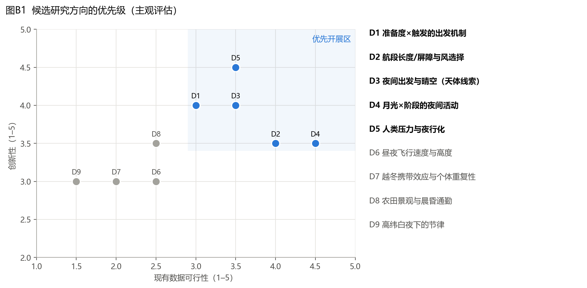
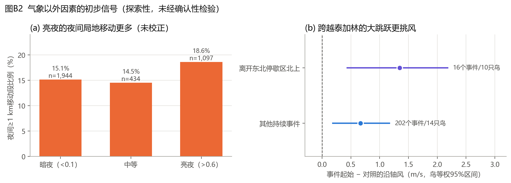

# 白额雁项目：潜在创新点与下一阶段研究方向

**日期：** 2026年11月9日
**定位：** 项目目前只分析了气象（风、温度），本文件梳理气象以外可整合的因素，评估每个方向的创新性与可行性，并给出推荐路线。
**初步信号来源：** `src/audit/explore_new_factors.py`（结果见 `docs/explore_new_factors.json`）。所有初步信号均为探索性筛查，不是确认性结论。

---

## 一、先厘清：哪些已经不新了

文献检索显示，同一越冬种群（鄱阳湖—东北平原—东西伯利亚）的以下内容已有发表，**很可能使用了与本项目相同或重叠的清华追踪数据**：

| 已发表内容 | 来源 |
|---|---|
| 春迁路线、东北平原是最重要停歇地（停留超过1个月）、停歇地保护空缺 | Si 等 2018，*Ecology and Evolution*（[PMC6024133](https://www.ncbi.nlm.nih.gov/pmc/articles/PMC6024133/)） |
| 越冬地与停歇地的农田利用、人类压力差异 | Si 等 2020，*Movement Ecology*（[PMC7437007](https://www.ncbi.nlm.nih.gov/pmc/articles/PMC7437007/)） |
| 东亚与其他欧亚种群的生境利用对比（156只） | Deng 等 2021，*Avian Research*（[s40657-021-00306-0](https://link.springer.com/content/pdf/10.1186/s40657-021-00306-0.pdf)） |
| 停歇地农田比例越高，飞行越频繁、移动越远 | 2021，*Global Ecology and Conservation*（[DOAJ](https://doaj.org/article/9783dd747af84f08a03b9beb5dcd67af)） |
| 东亚多物种跨越泰加林时几乎不停 | [PMC6479383](https://www.ncbi.nlm.nih.gov/pmc/articles/PMC6479383/) |
| 欧洲白额雁追踪温度加速期/绿波 | van Wijk 等 2012，*Oikos*（[记录](https://openpolar.no/Record/crwiley:10.1111%2Fj.1600-0706.2011.20083.x)） |
| 欧洲白额雁秋季风选择强于春季 | Kölzsch 等 2016，*Oikos*（[PDF](https://typeset.io/pdf/towards-a-new-understanding-of-migration-timing-slower-5mxat4yhtf.pdf)） |
| 白颊黑雁冬季月夜觅食，春季基本停止 | Westerduin & Nolet 2021，*Behavioral Ecology*（[记录](https://econpapers.repec.org/RePEc:oup:beheco:v:32:y:2021:i:3:p:539-552.)） |

**结论：** 路线、停歇地位置和生境利用这类描述性结果都不新。本项目的差异化优势在于：

1. **约2 h的高频定位**，能分辨昼夜和单次出发，而上述东亚研究多数关注停歇地尺度；
2. **同一批个体跨越冬和春迁**，可以在个体内比较两个阶段；
3. **已有的逐段ERA5匹配与风场框架**；
4. **设备瞬时地速和GPS高度**（8只鸟、609个飞行中定位点），可以确认飞行、估计飞行速度。

检索中**没有找到**针对东亚雁类的天气触发出发研究，也没有找到月光影响水禽夜间飞行的直接研究。这两个空白正好对应本项目的强项。

---

## 二、整合框架：把“昼夜”当作贯穿所有因素的轴

建议把出发决策拆成三层，每一层都问同一个问题：**白天和夜间有没有不同？**

| 层次 | 回答的问题 | 候选因素 | 主要数据来源 |
|---|---|---|---|
| **准备度**（能不能走） | 什么时候进入“可出发窗口” | 停歇已持续时间、日期/光周期、积雪融化、地温冻融、绿波（GWI/NDVI）、农田残粮被翻耕的时间 | ERA5-Land、MODIS积雪/NDVI、农事日历 |
| **触发**（哪一晚走） | 窗口内选哪一个时刻出发 | 风支持（多高度层）、风速、云量、降水、气压变化/锋面、月光 | ERA5单层+气压层、天文计算 |
| **执行**（怎么飞） | 出发后飞多远、多快、多高 | 航段长度、是否跨越泰加林、飞行地速、高度层风 | 设备瞬时地速、GPS高度、DEM |
| **背景压力**（贯穿全程） | 为什么某些地方更“夜行” | 人类足迹、夜间灯光、道路/村庄距离、保护区覆盖、夜栖湿地距离 | Human Footprint、VIIRS夜光、OSM、土地覆盖 |

---

## 三、候选创新点（按推荐优先级排序）

### D5　人类压力与“夜行化”：越冬与停歇期的昼夜活动转移

- **科学问题：** 在人类压力更高的地方，白额雁是否把移动和活动更多地转移到夜间？越冬地（鄱阳湖周边农田）和停歇地（东北平原）是否不同？
- **为什么新：** 人类干扰导致野生动物夜行化是近年全球关注的话题（如 Gaynor 等 2018，*Science*，需核实），但在迁徙水鸟、特别是东亚雁类中几乎没有用个体追踪数据检验过。Si 等 2020已经发现越冬地农田人类压力更高、雁类较少利用农田，本方向是在他们的空间结论上增加**时间（昼夜）维度**。
- **与项目主线的契合：** 直接回答“越冬与春迁的昼夜策略为何不同”，是原研究主线最好的机制性解释。
- **数据：** 现有逐段坐标即可；外部图层有 Human Footprint、VIIRS夜间灯光（Black Marble）、OSM道路与居民点、土地覆盖（CLCD或ESA WorldCover）。
- **分析：** 段尺度混合模型，响应为夜间移动/活动，解释变量为人类压力×阶段×昼夜，用鸟随机效应和个体内中心化处理个体差异；再用HMM把人类压力放进状态转移概率。
- **风险：** 人类压力与生境类型、纬度共线，需要在个体内、同一停歇区内比较。
- **评估：** 创新性高，可行性中高。

### D3　夜间出发需要晴空：天体导航线索假说

- **科学问题：** 夜间出发是否回避阴天（星空不可见），而白天出发对云量不敏感？
- **为什么新：** 它为“昼夜策略不同”提供了一个**可证伪的机制性预测**：夜间与白天可用的导航线索不同，所以对云量的依赖应当不对称。
- **数据：** ERA5总云量与低云量（GEE可直接提取，与现有风场流程一致）；出发事件需要包含黄昏出发，所以最好先恢复晨昏段。
- **分析：** 时间分层病例交叉设计，以云量×出发时刻（昼/夜/晨昏）的交互为核心检验，同时控制风支持。
- **评估：** 创新性高，可行性中高。

### D1　“准备度×触发”的出发机制

- **科学问题：** 物候/食物条件决定何时进入可出发窗口，天气决定窗口内具体哪一晚出发。两者是相加作用，还是窗口打开后风的作用才显现？
- **为什么新：** 欧洲研究分别检验过温度/绿波（van Wijk 2012）和风（Kölzsch 2016），但“窗口×触发”的交互、以及这种交互的昼夜差异，在东亚种群中尚未检验。东北平原积雪融化后才露出收获后残粮，是一个清晰的“食物开放”信号。
- **初步信号：** 事件起始沿轴风高于对照 +0.81 m/s [+0.39, +1.28]（见审计报告4.1）。
- **数据：** ERA5-Land积雪与地温、MODIS积雪（MOD10A1）、NDVI/绿波指数；停歇—出发事件需要全日连续轨迹。
- **分析：** 离散时间出发风险模型（每2 h一个时步），时变协变量为停歇时长、积雪/地温、风支持、云量，并检验准备度×风支持的交互。
- **评估：** 创新性高，但依赖原始轨迹，可行性中等。

### D4　月光对夜间活动的影响及其阶段差异

- **科学问题：** 月光是否提高夜间局地移动（觅食、换栖），而不影响迁飞？这种效应在越冬期和春迁停歇期是否不同？
- **为什么新：** 白颊黑雁的研究发现冬季月夜觅食、春季基本停止（Westerduin & Nolet 2021）。东亚白额雁在春季停歇期是否仍利用月夜，尚未检验；而且本项目可以直接比较越冬与春迁两个阶段。
- **初步信号：** 春迁夜间，亮夜（月面照亮>0.6且月亮在地平线上）的≥1 km移动比例为18.6%，暗夜为15.1%；在鸟×年份和月份固定效应模型中，β=+0.32 [+0.03, +0.61]。鸟等权差为+2.3个百分点 [−0.5, +5.3]（15只鸟），区间略跨零。≥10 km长距离移动与月光无关。这提示月光作用于局地活动，而不作用于迁飞。
- **数据：** 现有数据即可（月球位置由astropy计算），越冬段可以直接加入。
- **评估：** 可行性最高，创新性中等偏上。适合作为D5论文的一个组成部分，也可以单独写一篇短报。

### D2　风选择性随航段长度和屏障跨越而增强

- **科学问题：** 出发后要飞越的距离越长、越难中途停歇（如跨越泰加林），出发时对风是否越挑剔？
- **为什么新：** 它把“风选择”从是/否的问题变成了**决策代价**的问题：犯错代价越高，选择性应该越强。
- **初步信号：** 事件距离阈值越高，风效应越大（每m/s的OR在≥10 km时为1.08，≥50 km时为1.24）。从东北停歇区（44–50°N）出发、到达50°N以北的16个北上事件（10只鸟），起始沿轴风差为 +1.35 m/s [+0.43, +2.19]，约为其他事件（+0.66 [+0.17, +1.18]）的两倍。样本很小，只能作为线索。
- **评估：** 可行性高，创新性中等。适合并入D1的主论文，作为“执行层”的结果。

### D6　昼夜飞行速度与高度

- **初步信号：** 8只鸟的设备数据中，夜间飞行定位点的地速中位数为18.0 m/s，白天为15.9 m/s。差异可能来自夜间风支持更好或空速更高。椭球高中位数约302/316 m，需要用大地水准面（EGM2008）和DEM换算成离地高度后才能比较。
- **意义：** 如果能用对应气压层的风换算空速，就能区分“夜间挑风”和“夜间飞得更卖力”两种解释。
- **限制：** 只有8只鸟，H系列设备没有瞬时速度。适合作为补充分析。

### D7、D8、D9（暂缓）

- **D7 越冬携带效应与个体重复性：** 鄱阳湖水位/越冬条件 → 出发日期、东北停留时长；E002（4个春季）、E003和E005（各3个）可以估计个体重复性。重复个体太少，暂缓。
- **D8 农田景观与晨昏通勤：** 雁类在夜栖湿地和农田之间的往返主要发生在晨昏，而晨昏段恰好被剔除了。必须先恢复晨昏数据。
- **D9 高纬白夜下的节律：** 60–65°N几乎没有真夜，而65°N以北被截断，数据不足。

---

## 四、推荐路线：两篇论文 + 一个补充

| 论文 | 核心问题 | 整合的方向 | 关键前提 | 目标期刊 |
|---|---|---|---|---|
| **论文1（主论文）** | 春迁出发的“准备度—触发”机制及其昼夜差异：风、云与物候如何共同决定白额雁何时、在白天还是夜间出发 | D1 + D3 + D2 + 已有风场结果 | 恢复含晨昏的全日连续轨迹 | *Movement Ecology*、*Journal of Animal Ecology*（需结果清晰）、*Avian Research* |
| **论文2** | 越冬与春迁的昼夜活动差异：人类压力与月光如何塑造夜间活动 | D5 + D4（+ D8，如晨昏数据可得） | 外部人类压力图层；越冬段 | *Ecology and Evolution*、*Journal of Avian Biology*、*Biological Conservation*（偏保护应用） |
| 补充 | 昼夜飞行地速与高度 | D6 | 原始GPS中的全部飞行定位点、DEM、气压层风 | 并入论文1，或写短报 |

论文2只用现有冻结数据和外部图层就能启动，不受原始轨迹的限制，**可以和论文1的数据恢复工作并行**。

---

## 五、需要获取的外部数据

| 数据 | 用途 | 来源 | 获取难度 |
|---|---|---|---|
| ERA5气压层U/V（1000/925/850/700 hPa） | 飞行高度风支持 | GEE `ECMWF/ERA5/HOURLY`需改用气压层产品，或Copernicus CDS | 中 |
| ERA5总云量、低云量、海平面气压、降水 | D3云量、锋面/气压变化 | GEE ERA5单层产品（沿用现有流程） | 低 |
| ERA5-Land积雪、地温；MODIS MOD10A1积雪 | D1准备度（冻融、残粮暴露） | GEE | 低 |
| MODIS NDVI（MOD13Q1）/绿波指数 | D1物候 | GEE | 低 |
| 月球高度与照亮比例 | D4 | astropy计算（已实现） | 无 |
| Human Footprint、VIIRS夜光（VNP46A2） | D5人类压力 | GEE / 公开数据集 | 低 |
| OSM道路、居民点；CLCD/ESA WorldCover土地覆盖 | D5、D8 | 公开数据 | 低 |
| 鄱阳湖星子站水位 | D7越冬条件 | 水文年鉴/水文部门 | 中 |
| SRTM/Copernicus DEM、EGM2008大地水准面 | D6离地飞行高度 | GEE | 低 |
| **原始GPS + 4X辅助晨昏轨迹** | D1、D3、D8的前提 | 数据提供方 | **关键** |

---

## 六、近8周行动计划

| 周 | 任务 | 产出 |
|---|---|---|
| 1 | 联系数据提供方：取回原始GPS与4X辅助轨迹；确认使用授权与合作署名；查清同一数据集已发表的论文 | 数据与授权确认 |
| 1–2 | 用GEE补提取云量、气压、积雪、地温、NDVI；计算月光；叠加人类压力图层 | 扩展的逐段协变量表 |
| 2–3 | 论文2：越冬+春迁的夜间活动模型（D5 + D4），先在冻结数据上跑通 | 论文2的初步结果 |
| 3–5 | 基于全日轨迹重建停歇—出发事件，用瞬时地速确认飞行 | 出发事件表 |
| 5–7 | 论文1：病例交叉模型与离散时间风险模型（D1 + D3 + D2） | 论文1的主要结果 |
| 7–8 | 预先写定的敏感性分析；出版级图件；论文框架 | 两篇论文的初稿框架 |

**建议在第2周前写一份简短的分析预案**，列出D1–D5的核心假设、主模型和判定标准，避免在多个因素之间反复试探显著性。

---

## 七、风险与注意事项

1. **数据权属与重复发表：** Si 等 2018报告了21只个体、24条春迁轨迹（两个物种合计，需看原文确认白额雁数量），追踪年份与本项目重叠。必须与数据提供方确认是否为同一数据集，并在论文中说明与既有研究的关系。
2. **多重比较：** 加入的因素越多，偶然显著的风险越大。核心假设应控制在每篇论文2–3个，其余作为探索性结果单列。
3. **样本量：** 有效个体只有14–15只。所有效应都应以鸟为单位报告，并展示个体效应图。
4. **晨昏数据是瓶颈：** D1、D3、D8都依赖恢复晨昏段；如果拿不到，优先推进D5 + D4（论文2）。
5. **初步信号可能缩小：** 本文件中的月光、航段长度和飞行速度信号都来自事后筛查，样本小，没有校正多重比较。

---

## 参考资料

- Si Y. 等 2018. Spring migration patterns, habitat use, and stopover site protection status for two declining waterfowl species wintering in China as revealed by satellite tracking. *Ecology and Evolution*. [PMC6024133](https://www.ncbi.nlm.nih.gov/pmc/articles/PMC6024133/)
- Si Y. 等 2020. Reducing human pressure on farmland could rescue China's declining wintering geese. *Movement Ecology*. [PMC7437007](https://www.ncbi.nlm.nih.gov/pmc/articles/PMC7437007/)
- Deng X. 等 2021. *Avian Research*. [PDF](https://link.springer.com/content/pdf/10.1186/s40657-021-00306-0.pdf)
- 2021. *Global Ecology and Conservation*（停歇地农田与能量消耗）. [DOAJ](https://doaj.org/article/9783dd747af84f08a03b9beb5dcd67af)
- Bird satellite tracking revealed critical protection gaps in East Asian–Australasian Flyway. [PMC6479383](https://www.ncbi.nlm.nih.gov/pmc/articles/PMC6479383/)
- van Wijk R. E. 等 2012. Individually tracked geese follow peaks of temperature acceleration during spring migration. *Oikos*. [记录](https://openpolar.no/Record/crwiley:10.1111%2Fj.1600-0706.2011.20083.x)
- Kölzsch A. 等 2016. *Oikos*. [PDF](https://typeset.io/pdf/towards-a-new-understanding-of-migration-timing-slower-5mxat4yhtf.pdf)
- Westerduin C. & Nolet B. A. 2021. Nocturnal foraging lifts time constraints in winter for migratory geese but hardly speeds up fueling. *Behavioral Ecology*. [记录](https://econpapers.repec.org/RePEc:oup:beheco:v:32:y:2021:i:3:p:539-552.)
- Does the Tundra Bean Goose follow the green wave throughout its entire spring migration? *Pakistan Journal of Zoology*. [DOI](https://dx.doi.org/10.17582/journal.pjz/20190502130556)
- 清华大学地球系统科学系追踪项目新闻. [链接](https://www.dess.tsinghua.edu.cn/en/info/1079/1095.htm)

以上文献信息来自检索摘要，引用前请逐条核实原文。
