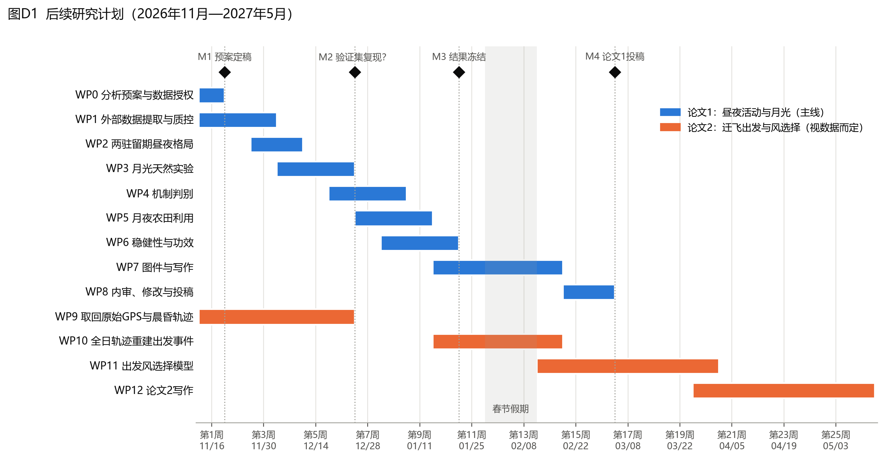

# 白额雁昼夜活动策略：后续研究计划

**编制日期：** 2026年11月9日
**计划周期：** 2026年11月16日（第1周）至2027年5月中旬（第26周）
**依据：** `docs/研究思路梳理.md` 确定的论文主线；预检数字见 `docs/nocturnal_precheck.json`

---

## 一、论文主线与总体目标

**主线（论文1）：**

> 同一批白额雁在鄱阳湖越冬期借助月光进行夜间活动，到东北春季停歇期则转为以白天活动为主。以月相作为天然实验，检验“时间—能量约束”“光照条件”和“回避人为干扰”三种解释。

**暂定题目：**
- 中文：月光、季节与人类压力：白额雁越冬地与春季停歇地昼夜活动策略的可塑性
- 英文：*Moonlit nights and busy days: seasonal plasticity in the diel activity of Greater White-fronted Geese along the East Asian Flyway*

**总体目标：**
1. 在第16周（2027年3月上旬）前完成论文1并投稿；
2. 同步取回原始GPS和晨昏轨迹，视数据情况在2027年5月前完成论文2（迁飞出发的风选择）初稿。

---

## 二、科学问题、假说与预测

### 2.1 四个科学问题

| 编号 | 问题 | 性质 |
|---|---|---|
| Q1 | 同一批个体在越冬期与春季停歇期的昼夜活动格局是否不同？ | 现象（已有信号） |
| Q2 | 月光是否提高夜间活动？效应在两个驻留期是否不同？ | 核心检验（越冬期已有信号） |
| Q3 | 夜间活动的驱动机制是时间—能量约束、光照，还是回避人为干扰？ | 机制判别 |
| Q4 | 亮夜的夜间移动是否更多地去往农田（“月夜农田利用”）？ | 拓展（未检验） |

### 2.2 假说与预测（判别表）

不同假说对各变量给出不同的预测，所以无论结果如何，都能指向某一种解释。

| 预测变量 | H1 时间—能量约束 | H2 光照条件 | H3 回避人为干扰 |
|---|---|---|---|
| 夜长 | 夜越长，夜间活动越多 | 无关 | 无关 |
| 夜间气温 | 越冷，夜间活动越多（能量需求高） | 无关 | 无关 |
| 月光效应的阶段差异 | 越冬期强、停歇期弱 | 两个阶段相近 | 不定 |
| 云量 × 月光 | 云层削弱月光效应 | 云层削弱月光效应 | 不削弱 |
| 人类压力（人类足迹、夜间灯光、离村庄距离） | 无关 | 无关 | 压力越高，夜间活动越多 |
| 夜间移动终点的土地类型 | 不定 | 不定 | 更多为农田 |

**额外的阴性对照（排除伪影）：**
- 白天段与月光无关；
- 把月相整体平移约半个周期（14.8天）后，“伪月光”应该没有效应。

如果阴性对照出现效应，就说明结果来自采样或季节伪影，而不是月光本身。

---

## 三、研究设计

1. **两个驻留期对比：** 只比较鄱阳湖越冬期和东北停歇区（45–50°N）停歇期，排除迁飞段（≥10 km），从根本上避开春迁昼夜比较中的纬度混杂。
2. **个体内比较：** 同一只鸟在不同夜晚之间比较（亮夜 vs 暗夜），在两个驻留期之间比较（8只鸟两地都有数据）。
3. **月相天然实验：** 月相与天气、地点和鸟的选择无关，每个越冬季覆盖约3–4个月相周期。
4. **建模—验证拆分：** 用2015/16冬季（20只鸟、2,062个夜间段）建模，用2016–2019年其余冬季（约2,310个夜间段）验证；春季停歇期按年份做同样的拆分。
5. **分析单位：** 主分析以“鸟×夜”为单位（夜内≥1 km段数 / 夜内总段数，二项分布），减少2 h段之间的时间自相关；逐段模型作为敏感性分析。

---

## 四、数据

### 4.1 现有数据（足以完成论文1）

| 数据 | 规模 |
|---|---|
| 越冬期夜间段 | 4,372段，20只鸟，4个越冬季 |
| 春季停歇期夜间段（45–50°N） | 2,825段，15只鸟 |
| 两地都有数据的个体 | 8只 |
| 逐段ERA5 | 风速、气温、降水（已匹配） |

### 4.2 需要新增的外部数据

| 变量 | 数据源 | 分辨率 | 用途 | 难度 |
|---|---|---|---|---|
| 月球高度、照亮比例 | astropy计算（已实现） | 逐段 | Q2核心暴露 | 无 |
| 总云量、低云量 | ERA5 单层（GEE `ECMWF/ERA5/HOURLY`） | 0.25°，逐时 | 有效月光 = 月光 × (1 − 云量) | 低 |
| 夜长 | 由日出日落时间计算 | 逐段 | H1 | 无 |
| 土地覆盖（农田、湿地、水体、居民地） | CLCD年度30 m中国土地覆盖 / ESA WorldCover | 30 m / 10 m | Q4、H3 | 低 |
| 人类足迹 | Human Footprint 数据集 | 1 km | H3 | 低 |
| 夜间灯光 | VIIRS Black Marble（VNP46A2） | 500 m，逐日 | H3 | 低 |
| 道路、居民点 | OpenStreetMap | 矢量 | H3（距离变量） | 低 |
| 夜栖湿地距离 | 由夜间定位聚类 + 土地覆盖 | 逐段 | 控制变量 | 中 |
| 鄱阳湖水位（可选） | 星子站水文资料 | 逐日 | 越冬生境可用性 | 中 |

### 4.3 需要向数据方申请（主要用于论文2）

- 原始GPS文件（含设备瞬时地速、GPS高度）；
- 4X辅助晨昏轨迹；
- 数据使用授权、合作署名方式，以及与 Si 等 2018/2020 的关系说明。

---

## 五、工作包（论文1）

### WP0　分析预案与数据授权（第1周，11/16–11/22）
- 写一页分析预案：Q1–Q4的主模型、假说预测、判定标准、阴性对照，存档（建议上传OSF或放入仓库并打标签），作为里程碑M1。
- 联系数据提供方，确认授权与已发表成果。

### WP1　外部数据提取与质控（第1–3周）
- GEE批量提取云量；叠加土地覆盖、人类足迹、夜间灯光、OSM距离；计算夜长和月光。
- 产出：扩展协变量表（每个夜间段一行），附字段说明和来源；新增脚本 `src/analysis/01_build_covariates.py`。
- 质控：缺失率、空间对位抽查（随机抽50个点人工核对土地类型）。

### WP2　两驻留期昼夜格局（第3–4周，Q1）
- 模型：`活动 ~ 驻留期 × 昼夜 + (1 | 鸟) + (1 | 鸟:季节)`（二项GLMM）。
- 昼夜节律曲线：按当地太阳时的循环样条GAM，比较两个驻留期的24 h活动曲线。
- 报告：同鸟配对差中差（预检 +15.1个百分点 [+9.0, +19.6]）、个体效应图。

### WP3　月光天然实验（第4–6周，Q2）
- 主模型（鸟×夜单位）：
  `夜间活动 ~ 月光 × 驻留期 + 夜长 + 气温 + 风速 + 降水 + (1 + 月光 | 鸟) + (1 | 鸟:季节)`
- 用2015/16冬季建模，在其余冬季验证（里程碑M2）。
- 阴性对照：白天段 vs 月光；月相平移14.8天的伪月光。
- 剂量—反应：有效月光（考虑云量）是否比名义月光更能解释夜间活动。

### WP4　机制判别（第6–8周，Q3）
- 在WP3模型中加入人类压力变量及其与月光的交互。
- 建立三个与假说对应的模型（H1、H2、H3）和一个综合模型，用留一鸟交叉验证的预测表现进行比较，不只看AIC。
- 按第二节的判别表逐项给出判定。

### WP5　月夜农田利用（第7–9周，Q4）
- 对越冬期夜间≥1 km移动，判断终点的土地类型（农田 / 湿地 / 其他）。
- 模型：`终点为农田 ~ 月光 + 人类压力 + (1 | 鸟)`；白天移动作为对照。
- 如果成立，再看这些夜间农田点离居民点和道路的距离，形成保护建议（夜间农田避难区、控制光污染）。

### WP6　稳健性与功效（第8–10周）
- 移动阈值0.5 / 1 / 2 km；逐段模型 vs 鸟×夜模型；逐只剔除鸟；按季节逐一剔除。
- 时间自相关（AR(1)残差结构）与空间自相关检查。
- 功效报告（见第六节）；所有结果冻结，作为里程碑M3（1/24）。

### WP7　图件与写作（第10–14周，跨春节）
- 出版级图件（见第八节），撰写全文。

### WP8　内审、修改与投稿（第15–16周）
- 合作者内审、语言润色、数据可得性声明、代码公开（仓库打版本标签），投稿（里程碑M4，3/7前）。

---

## 六、功效评估与提高功效的办法

由预检的置信区间反推（α = 0.05，功效80%，最小可检测效应 ≈ 2.8 × 标准误）：

| 检验 | 预检估计 | 标准误 | 最小可检测效应 | 结论 |
|---|---:|---:|---:|---|
| 越冬期月光效应 | β = 0.57 | 约0.17 | 约0.47 | **功效足够**，作为确认性检验 |
| 停歇期月光效应 | β = 0.14 | 约0.23 | 约0.66 | 不足以检测与越冬期同等大小（0.57）的效应 |
| 两阶段差异（交互） | −0.37 | 约0.31 | 约0.86 | **功效不足**，只能做估计，不做显著性判定 |

**由此确定的报告策略：**
- 越冬期月光效应作为**确认性**结论；
- 停歇期效应和阶段差异作为**估计**结果，报告效应量和置信区间，不宣称“显著不同”，也不宣称“停歇期没有效应”。

**提高功效的办法（按优先级）：**
1. 鸟×夜二项模型，比逐段二分类更有效率；
2. 用连续的有效月光（考虑云量），代替亮/暗二分；
3. 加入夜间移动距离（log1p）作为第二响应；
4. 拿回晨昏轨迹后，增加每晚可用的段数。

---

## 七、可能的结果与解释

| 情景 | 结果组合 | 解释与论文写法 |
|---|---|---|
| A（预期） | 越冬期月光效应在验证集复现；夜长/气温有正效应；人类压力无关 | 支持时间—能量约束：冬季昼短，需要借月光补充夜间觅食；与欧洲白颊黑雁一致，首次在东亚种群中证实 |
| B | 越冬期与停歇期月光效应相近 | 支持光照本身的作用，与季节能量需求无关 |
| C | 人类压力高处夜间活动多，且夜间移动终点偏向农田 | 支持回避人为干扰，“月夜农田利用”成立，保护意义最强 |
| D | 越冬期效应在验证集中不复现 | 不再以月光为主线；改为以Q1（两驻留期昼夜格局的可塑性）为核心的描述性论文，月光作为探索性结果报告 |

情景A到C都能支撑一篇完整论文；情景D也有退路，所以不存在“什么都做不出来”的情况。

---

## 八、论文1框架（预设图表）

| 部分 | 内容 |
|---|---|
| 图1 | 研究区与设计：鄱阳湖与东北停歇区地图、个体轨迹示意、月相天然实验示意 |
| 图2 | 两驻留期的24 h活动曲线与同鸟配对差中差（Q1） |
| 图3 | 月光效应：越冬期 vs 停歇期，建模集 vs 验证集，含阴性对照（Q2） |
| 图4 | 机制判别：夜长、气温、人类压力、云量 × 月光的效应量（Q3） |
| 图5 | 月夜农田利用：夜间移动终点的土地类型构成（Q4） |
| 表1 | 样本结构（个体、季节、夜数） |
| 表2 | 假说判别表与结果对照 |
| 补充材料 | 阈值敏感性、逐只剔除、逐段模型、功效分析、数据处理流程 |

**目标期刊（按匹配度）：** *Behavioral Ecology* → *Journal of Avian Biology* / *Avian Research* → *Ecology and Evolution*。若情景C成立，可考虑 *Biological Conservation* 或 *Journal of Applied Ecology*。

---

## 九、论文2（迁飞出发与风选择，视数据而定）

| 工作包 | 时间 | 内容 |
|---|---|---|
| WP9 取回原始数据 | 第1–6周 | 原始GPS、4X晨昏轨迹；第6周（M2）判断是否到位 |
| WP10 重建出发事件 | 第10–14周 | 用全日连续轨迹识别停歇→出发→持续移动；用瞬时地速确认飞行 |
| WP11 出发模型 | 第14–20周 | 时间分层病例交叉设计；925/850 hPa风支持、云量、气压变化；风支持 × 出发时刻（昼/夜/晨昏） |
| WP12 写作 | 第20–26周 | 初稿 |

**基础：** 更正后的出发顺风效应（+0.81 m/s）；航段越长越挑风的线索。
**如果第6周时原始数据仍未到位：** 论文2暂停，用冻结数据写成短报（出发时顺风更强、风速更低），或并入论文1的讨论部分。

---

## 十、决策节点

| 节点 | 时间 | 判断内容 | 不通过时的处理 |
|---|---|---|---|
| M1 | 第1周末（11/22） | 预案定稿；数据授权是否明确 | 授权不明确时暂停投稿准备，分析继续 |
| M2 | 第6周末（12/27） | 越冬期月光效应在验证集中是否复现；原始数据是否到位 | 不复现 → 切换情景D；数据未到位 → 论文2降级 |
| M3 | 第10周末（1/24） | 全部结果冻结，不再增加新变量 | 不再新增分析，进入写作 |
| M4 | 第16周末（3/7） | 论文1投稿 | 顺延不超过2周 |

---

## 十一、风险与应对

| 风险 | 可能性 | 应对 |
|---|---|---|
| 数据授权或与已发表成果重叠 | 中 | 第1周即联系数据方；在论文中明确与 Si 等的区别（他们是空间与生境，本研究是昼夜与机制） |
| 越冬期效应在验证集中不复现 | 低—中 | 情景D退路；建模前已写定预案，避免事后挑选 |
| 停歇期样本功效不足 | 高 | 按估计结果报告；不做“两阶段显著不同”的结论 |
| 人类压力图层分辨率太粗 | 中 | 用OSM居民点和道路的距离作补充；同一停歇区内做个体内比较 |
| ≥1 km移动无法区分觅食和换栖地 | 高（数据硬限制） | 用终点土地类型间接区分；在讨论中如实说明；建议后续追踪加装加速度计 |
| 春节期间进度放缓 | 高 | 计划中已留出第12–13周缓冲 |

---

## 十二、代码与交付物

| 交付物 | 位置 |
|---|---|
| 分析预案 | `docs/分析预案.md`（WP0） |
| 协变量构建 | `src/analysis/01_build_covariates.py` |
| Q1–Q4 模型脚本 | `src/analysis/02_diel_pattern.py` … `05_farmland_night.py`（或R：glmmTMB、mgcv） |
| 稳健性与功效 | `src/analysis/06_robustness.py` |
| 图件 | `src/analysis/figures/`，输出到 `docs/figures/` |
| 论文1稿件 | `manuscript/`（投稿前不公开，建议届时将仓库设为私有） |

**建议的软件分工：** 数据准备沿用Python；二项GLMM（含随机斜率）和循环样条GAM建议使用R的 glmmTMB 与 mgcv，比Python的 statsmodels 更成熟，也是审稿人熟悉的方法。
