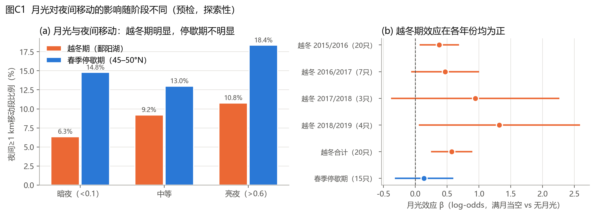

# 研究思路梳理：已做工作、研究现状、局限、突破口与创新点

**日期：** 2026年11月9日
**用途：** 把前期阶段分析、独立审计和预检结果串成一条清晰的逻辑线，作为下一阶段的工作底稿。详细数字见 `docs/项目理解与审计报告.md`、`docs/创新点与研究方向.md` 和 `docs/nocturnal_precheck.json`。

---

## 一、一句话说清课题现状

原课题研究**同一批白额雁在越冬期和春迁期的昼夜移动策略差异**。昼夜差异这个**现象**已经清楚（两个阶段都是白天多、夜间少），但**为什么**还没有回答。

目前只用气象（风、气温）去解释，而风主要作用于迁飞，迁飞段只占全部GPS段的很小一部分。昼夜差异主要发生在驻留期的局地活动中，风解释不了这部分，所以课题卡住了。

---

## 二、已做的工作

### 2.1 原课题阶段（Phase 5a–5d-2C）

| 阶段 | 做了什么 | 主要结果 | 可信度 |
|---|---|---|---|
| 5a 数据冻结 | 21只鸟，17,784个约2 h移动段（越冬7,692 / 春迁10,092）；按太阳高度划分昼夜，剔除晨昏 | 数据质量高、可追溯 | 高 |
| 5c 气象匹配 | 逐段匹配ERA5风、气温、降水 | 17,784段全部匹配 | 高 |
| 5d-1 移动状态 | 连续长距离过程、候选停歇 | 224个连续过程；严格口径下≥24 h停歇为0（晨昏剔除所致） | 中 |
| 5d-2 阶段×昼夜 | 净位移率混合模型 | 两阶段都是夜<昼；阶段间差中差在14只鸟等权口径下跨零；12个模型诊断均未通过 | 现象可信，差中差不稳健 |
| 5d-2A 风向重构 | 鸟×年份季节路线轴，计算顺/逆风 | 覆盖96.9%；但沿轴风≈南风分量（r=0.989） | 中 |
| 5d-2B 段尺度风模型 | ≥30 km发生与距离 | 顺风越强越易出现长距离位移（白天每m/s的OR为1.04）；残差自相关0.58 | 探索性 |
| 5d-2C 出发风场 | 224个事件起始与对照比较 | 原结论“顺风无效应” | **结论有误**（见2.2） |

### 2.2 独立审计与预检（本轮新增）

| 工作 | 结果 |
|---|---|
| 复现 | 5d-2B模型系数、5d-2C的224个事件和6,976个对照全部逐位复现 |
| 更正5d-2C | 原分析用了截断为非负的段内平均顺风。改用有符号起点风后，出发时顺风比对照强 **+0.81 m/s [+0.39, +1.28]**，在同一太阳时的对照下仍为+0.58 m/s [+0.07, +1.05] |
| 发现晨昏截断 | 16时是长距离位移最多的时刻，但只有5%能连成持续事件；224个事件中没有一个跨越昼夜 |
| 发现纬度混杂 | 春迁夜间样本比例从约40%（<45°N）降到1%（60–65°N）；只看50°N以南时，夜间效应区间跨零 |
| **预检：月光** | 越冬期夜间≥1 km移动：暗夜6.3% → 中等9.2% → 亮夜10.8%；β=+0.57 [+0.25, +0.90]；逐只剔除20只鸟后仍为正（0.46–0.70）；4个越冬季点估计都为正；鸟等权差+4.0个百分点 [+1.6, +6.8]，10只鸟中9只为正 |
| 预检：停歇期月光 | 春季东北停歇区（45–50°N）β=+0.14 [−0.32, +0.60]，不明显；与越冬期的差异 −0.37 [−0.97, +0.24]，**尚未达到统计显著** |
| **预检：同一只鸟两地对比** | 排除≥10 km的迁飞段、只看局地移动：越冬期白天15.6%、夜间7.6%；停歇期白天31.1%、夜间16.9%。8只两地都有数据的鸟中，停歇期的昼夜差比越冬期大 **+15.1个百分点 [+9.0, +19.6]**，7只方向一致 |
| 预检：个体一致性 | 越冬与春季的夜行程度相关 −0.31（不显著）；重复性0.18–0.39。**不成立，放弃** |

---

## 三、研究现状（领域）

| 已经知道的 | 来源 |
|---|---|
| 东亚白额雁的春迁路线、东北平原是核心停歇地（停留超过1个月） | Si 等 2018，*Ecology and Evolution* |
| 越冬地农田人类压力高，雁类白天很少利用农田；停歇地大量利用农田 | Si 等 2020，*Movement Ecology* |
| 东亚种群与其他欧亚种群生境利用不同 | Deng 等 2021，*Avian Research* |
| 欧洲白额雁春迁跟随温度/绿波；秋季风选择比春季强 | van Wijk 等 2012；Kölzsch 等 2016，*Oikos* |
| 欧洲白颊黑雁冬季月夜觅食，春季基本停止（加速度计数据） | Westerduin & Nolet 2021，*Behavioral Ecology* |

| 尚未研究的（检索未见） |
|---|
| 东亚雁类**昼夜活动的驱动机制** |
| 同一批个体在**越冬地与停歇地之间**如何调整昼夜策略 |
| 月光对东亚雁类夜间活动的影响 |
| 东亚雁类出发的天气触发机制 |

**结论：** 路线、停歇地、生境利用这些描述性内容已经发表（很可能用的是同一批或重叠的数据），不能再作为创新点。**昼夜维度和机制解释是空白。**

---

## 四、局限

### 4.1 数据本身的硬局限（无法改变，论文中如实说明）

1. **个体少：** 有效个体14–15只，两个阶段都有数据的只有8只。
2. **定位间隔约2 h：** 净位移不等于飞行，也不能区分觅食、换夜栖地和迁飞。
3. **没有加速度计：** 无法直接判断行为类型，只能用移动距离代替活动。
4. **气象分辨率：** ERA5约28 km网格；10 m风不等于飞行高度的风。
5. **轨迹不完整：** H系列只有一个不完整的春季；E001–E005的2015年轨迹从迁徙途中开始。

### 4.2 分析层面的局限（可以修正）

| 局限 | 修正办法 | 状态 |
|---|---|---|
| 晨昏段被剔除，黄昏出发和晨昏往返被截断 | 取回原始GPS和4X辅助轨迹 | 待数据 |
| 春迁“昼夜”与纬度/季节混杂 | 只比较两个驻留期（鄱阳湖 vs 东北停歇区） | **已可解决** |
| 顺风变量口径错误 | 改用有符号起点风 | 已更正 |
| 逐段模型时间自相关 | 改用事件模型或状态模型 | 待做 |
| 代码不完整、路径写死 | 补齐脚本 | 部分完成 |

---

## 五、突破口

原课题卡住，是因为**用“风”去解释“昼夜差异”**：风只作用于少数迁飞段，而昼夜差异主要来自驻留期的局地活动（越冬期全部、春季约77%的段都在东北停歇区）。

**突破口是两个转变：**

1. **研究对象转变：** 从“迁飞”转向“驻留期的昼夜活动”，比较**同一只鸟**在鄱阳湖越冬期和东北停歇期的表现。这样既去掉了纬度混杂，也让阶段比较变成“同类比同类”。
2. **解释变量转变：** 从风转向**月光**。月相与天气、地点、鸟的行为都无关，每个月在同一只鸟身上自然产生亮夜和暗夜的对比，是一个**天然实验**，因果识别比风干净得多。

**为什么可行：**

- 现有冻结数据就够，不依赖拿回原始轨迹；
- 核心信号已经出现，并且通过了逐只剔除和分年份检查；
- 有现成的机制框架（白颊黑雁的“冬季时间—能量约束”），无论结果是重复还是不同，都能解释。

---

## 六、创新点

| 序号 | 创新点 | 证据状态 | 定位 |
|---|---|---|---|
| **1** | **同一批个体的昼夜策略在越冬地与春季停歇地之间可塑**：停歇期白天活动大幅增加，昼夜差比越冬期大约15个百分点 | 已有，8只鸟中7只一致；需用混合模型确认 | 核心 |
| **2** | **月光驱动越冬期夜间活动**：东亚种群、GPS数据中的首次检验，与欧洲白颊黑雁的结论相互印证 | 越冬期稳健；停歇期不明显；两阶段差异尚未显著 | 核心 |
| **3** | **夜间活动的机制判别**：时间—能量约束（夜长、低温）vs 光照（月光）vs 回避人为干扰（人类足迹、夜间灯光、农田），并检验“月夜农田利用” | 未检验，需叠加土地覆盖和人类压力图层 | 机制拓展，创新性最高 |
| 4 | **迁飞出发的风选择（更正后）**：出发时顺风更强、风速更低；航段越长越挑风 | 探索性，样本小 | 第二篇论文或补充 |

**表述上要注意：** “月光效应因阶段而异”目前只能说“越冬期稳健、停歇期不确定”，不能说两阶段显著不同，因为交互项区间跨零。

**建议的论文主线：**

> 同一批白额雁在越冬地和春季停歇地采用不同的昼夜活动策略：越冬期借助月光进行夜间活动，春季停歇期则转为以白天活动为主。我们用月相作为天然实验，并检验时间—能量约束与回避人为干扰两种解释。

**已经排除、不再投入的方向：** 个体夜行性一致性；继续堆叠逐段风模型；把30 km净位移直接当作飞行。

---

## 七、下一步（约4周，不依赖新GPS数据）

| 周 | 任务 |
|---|---|
| 1 | 写一页分析预案（主模型、假说预测、判定标准）；为全部夜间段计算月光，叠加土地覆盖（CLCD）、人类足迹、VIIRS夜间灯光、夜长和气温 |
| 2 | 混合模型（鸟随机效应）：活动 ~ 月光 × 阶段 + 夜长 + 气温 + 人类压力；用2015/16冬季建模，其余冬季验证 |
| 3 | 检验“月夜农田利用”：亮夜的夜间移动是否更多落在农田 |
| 4 | 出版级图件与初稿；同时联系数据方取回原始轨迹，为创新点4做准备 |

**同时要确认：** 数据使用授权、与 Si 等 2018/2020 是否为同一数据集。

可投期刊：*Behavioral Ecology*、*Journal of Avian Biology*、*Avian Research*、*Ecology and Evolution*。
