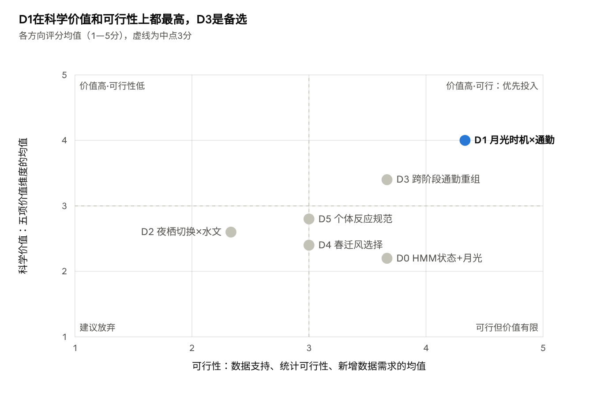
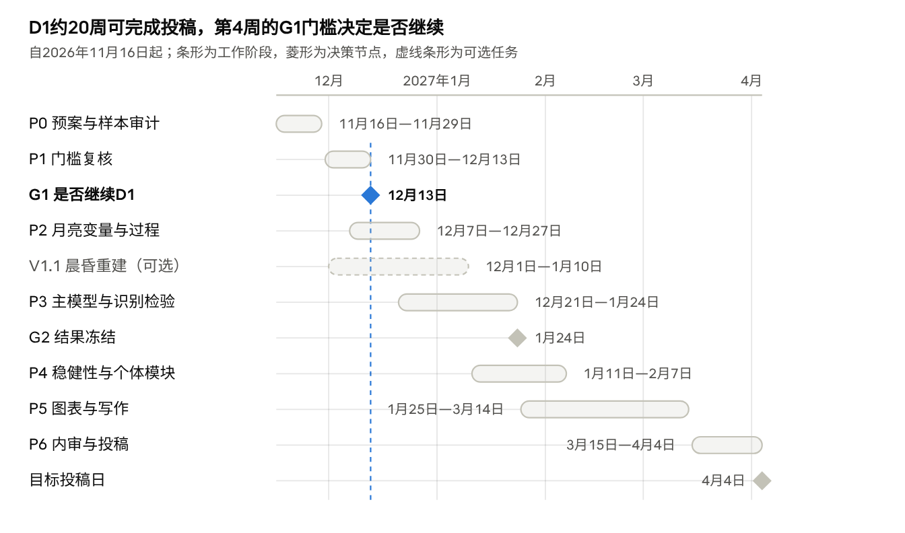

# 白额雁GPS追踪项目：研究瓶颈诊断、创新方向评估与研究框架重构

日期：2026-11-14　｜　本文件由在线文档导出；在线版中的两张交互图在此以静态图片呈现。

## 结论速览

建议把论文主线定为"月光时机与越冬白额雁的昼—夜通勤周期"（D1，评分33/40），备选为"越冬地与东北停歇地之间昼夜通勤系统的重组"（D3，28/40）。两者都只用冻结数据，不依赖个体性状。

- **瓶颈判定：** 主要在科学问题和研究设计，不在数据量。晨昏剔除切掉了通勤和出发；春季停歇候选用低位移定义，比较其移动是循环论证。
- **本次核查的关键发现：** 越冬"20只鸟"中10只E系列鸟提供97%的段；H系列越冬数据几乎只有2015年12月的几天，很可能紧挨放飞。此前的个体异质性与设备系列和放飞期混杂。
- **风场结论有两个相反版本：** 进度报告为+0.158 m/s（区间跨零），11月9日审计更正变量后为+0.81 m/s \[+0.39, +1.28\]。对齐前不应写入论文。
- **夜间移动是什么过程：** 越冬夜间≥1 km位移以入夜后、远离白天活动区的单向转移为主（208个鸟夜），外出后返回的只有13个。
- **D1的新意：** 用月亮在夜内的出没时机（傍晚月 vs 黎明月）区分"当时的光照"与"月相周期"。最接近的 Lameris et al. (2021) 只用每夜月光时长。"月光增加越冬雁类夜间活动"本身不是创新点。
- **最大不确定性：** 月光的有效重复只有约14个朔望月、10只鸟；剔除H系列放飞期后WP3效应可能减弱。第4周的G1门槛决定是否继续D1。
- **暂缓或并入：** D2（需水位数据）和D4（风变量冲突）暂缓；D5、11月13日的HMM方案并入D1作为模块。
- **期刊与进度：** D1结果清晰时可投Behavioral Ecology、Movement Ecology、Journal of Avian Biology；按计划约2027年4月初投稿。

## 第一部分 现有研究诊断

项目的瓶颈主要不在数据量，而在两处研究设计缺口（剔除晨昏段、用低位移定义春季停歇）和问题层次（停留在"有没有差异"）。冻结数据足以支撑一篇以越冬期为核心、回答"夜间移动属于什么过程、由什么光照条件触发"的论文。

本节结论来自两部分：一是11月14日进度报告和11月9日内部文档；二是本次对冻结文件 `Phase5a_Frozen_Movement_Data.csv` 的只读核查（未改动任何数据，标注为"本次核查"）。

### 1.1 证据可靠的结论

| 结论 | 关键数字 | 可靠程度 | 必须附带的限定 |
| --- | --- | --- | --- |
| 越冬期夜间净位移率低于白天 | 段级β = −0.151，整鸟Bootstrap \[−0.177, −0.111\] | 高 | 鸟等权原尺度差 −0.0125 km/h \[−0.068, +0.069\] 跨零：种群层面的幅度不确定 |
| 越冬期存在日周期 | 周期GAMM EDF 5.74，整鸟重抽样支持 | 高 | 05、06、16时无数据，不能判断晨昏峰值 |
| 月光与越冬夜间≥1 km位移比例正相关 | OR 1.245 \[1.113, 1.422\]；P25→P75 +2.12个百分点 | 中高 | 19次留一鸟均为正；但留一鸟预测未改善（对数损失0.9840→0.9855） |
| 环境变量匹配完整 | ERA5 17,784/17,784；月光几何与云量完成 | 高 | ERA5约28 km网格；月光指数是相对代理 |

### 1.2 仍不稳定的结论

| 结论 | 现状 | 不稳定的原因 |
| --- | --- | --- |
| 春迁与越冬昼夜差异不同 | 14只共同鸟差中差 −0.104 km/h \[−0.413, +0.123\] | 个体间差异大；H003单鸟主导原尺度汇总 |
| 春季停歇夜少于昼 | B336区间不含零，B317删失敏感性 \[−0.0296, +0.0046\] 含零 | 4只鸟；E010贡献224/336段 |
| 顺风促进长距离移动 | 进度报告：+0.158 m/s \[−0.158, +0.557\] | **与11月9日独立审计冲突**：审计指出原变量把段内顺风截断为非负，改用有符号起点风后为 +0.81 m/s \[+0.39, +1.28\]。两个版本必须先对齐，才能下任何风场结论 |
| 人类压力无独立效应 | HFP β = −0.084，区间跨零 | HFP是2009年背景；不透水面多数为0；逐日夜光未匹配。属于测量不足，不是"无效应" |
| 月光是最佳解释因子 | M2的AICc最低，但M3的留一鸟评分最低 | 拟合与预测指标不一致；校准斜率 −0.188 |

### 1.3 本次核查发现的五个结构性问题

1. **越冬"20只鸟"实际是10只鸟的数据。** E系列10只鸟提供7,453/7,692段（97%）；H系列10只鸟只有239段，越冬夜集中在2015年12月10—21日，每只2—6夜。H系列没有设备瞬时速度，夜间≥1 km比例为0.160，E系列为0.079。这些轨迹起点紧挨捕捉日期的可能性很大，需用放飞记录核实；若属实，应按放飞后适应期剔除（参见 Geen et al. 2019；Schreven et al. 2024）。**此前看到的个体异质性，有相当部分可能是设备系列和放飞后时段的混杂。**
2. **晨昏剔除切掉了昼夜策略最集中表达的时段。** 冻结规则为白天太阳高度≥−0.833°、夜间<−6°，中间段全部排除。这直接造成05、06、16时无数据，严格口径下≥24 h停歇为0，224个长距事件无一跨越昼夜。雁类的早晚通勤和黄昏出发恰好在这个窗口内。
3. **春季停歇候选B506用低位移定义，比较其移动是循环论证。** 它按500 m范围、≥3.5 h识别，最大单段0.484 km是定义的结果，不是行为发现。停歇应在区域驻留尺度上定义（例如连续多日停留在某个区域内）。
4. **"2,825"已可复现。** 它等于春迁夜间段中起点纬度45—50°N的段数（两端都在该带内为2,819段），来自11月9日预检的纬度带口径。它可以复现，但只是东北停歇区子集，不能作为完整走廊的分母。
5. **数据来源与已发表论文重叠。** 原始文件为"2015 Tsinghua waterfowl (Yangtze)"。Si et al. (2018, 2020) 用鄱阳湖捕捉的白额雁卫星追踪数据发表了春迁路线、停歇地和农田利用结果（2020年为55只白额雁）。本项目21只鸟很可能是其子集。因此路线、停歇地和生境利用都不能作为创新点，投稿前必须确认数据授权与既有发表的关系。

此外，11月9日内部文档把关键对照文献写成"Westerduin & Nolet 2021"，实际第一作者是 Lameris 等（Behavioral Ecology 32:539–552）。

### 1.4 不值得继续投入的分析

- 把越冬、春迁、停歇三个阶段放在同一模型中检验阶段×昼夜交互。
- 在B506/B336内继续做昼夜比较（循环定义加4只鸟）。
- 越冬与春季"夜行程度"的个体一致性（8只鸟，r = −0.31，不显著，已被内部判定放弃）。
- 继续堆叠段尺度风场变量。先解决风变量版本冲突，再决定是否保留。
- 用体重、翼长等缺失性状解释个体差异；把夜光下载作为主线前提（11月10日已关闭）。
- 在WP4竞争模型中继续增加协变量而不增加新假设，这会扩大分析路径的自由度。

### 1.5 瓶颈来源判定

| 来源 | 判定 | 依据 |
| --- | --- | --- |
| 科学问题 | **主要瓶颈** | 问题停在"阶段或昼夜之间有没有差异"，没有问"夜间移动是什么过程、由什么触发" |
| 研究设计 | **主要瓶颈** | 晨昏剔除；春季停歇用位移定义；以段而非过程作分析单位 |
| 创新性 | 次要瓶颈 | 月光效应在白颊黑雁中已有加速度计证据（Lameris et al. 2021）；新意必须来自机制和识别设计 |
| 个体数量 | 限制个体层面推断 | 越冬有效个体10只；个体反应规范的方差估计精度有限（Martin et al. 2011） |
| 数据量 | 不是瓶颈 | 10只E系列鸟各有13—258个越冬夜，个体内重复观测充足 |

## 第二部分 潜在研究方向

这批数据最能回答的问题，不是"昼夜是否不同"，而是"越冬白额雁夜间那部分移动是什么过程、在什么光照时机发生"。下面先回答任务书的四个关键问题，再给出五个候选方向，并把11月13日既定方案作为对照。

### 2.1 没有生物学性状，能否研究个体差异

能研究，但只能回答"个体内可塑性"和"个体间方差有多大"，不能回答"差异来自什么性状"。四个概念必须分开：

| 概念 | 含义 | 现有数据能否估计 | 方法 | 可以说 / 不能说 |
| --- | --- | --- | --- | --- |
| 个体差异 | 同样环境下个体平均行为水平不同 | 能，但有效个体只有10只 | 鸟随机截距、重复性（Nakagawa & Schielzeth 2010） | 可说"存在个体间方差"；不能说其来源 |
| 个体行为可塑性 | 同一个体随环境改变行为 | 能，最可靠 | 个体内中心化的环境斜率（van de Pol & Wright 2009） | 可说"同一只鸟在月亮在天时更常转移" |
| 个体环境响应差异 | 个体之间斜率（反应规范）不同 | 只能估计，难以检验 | 随机斜率、部分合并的个体斜率（Dingemanse et al. 2010；Hertel et al. 2020） | 10只鸟下斜率方差区间很宽（Martin et al. 2011），只报告估计和区间 |
| 个体性状效应 | 体重、翼长、性别等解释个体差异 | 不能 | 需要性状数据，且10只鸟不足以检验 | 不能归因于任何性状 |

**区分个体差异与环境差异的办法：**

- 个体内中心化：把环境变量拆成鸟均值与鸟内偏差。
- 同日对照：2015/16冬季12月18日以后最多10只E系列鸟同时在追踪，共享同一夜的月光与天气。
- 必须控制的混杂：设备系列（E/H）、放飞后适应期、越冬季、越冬湖泊。E002、E005、E013、E018的冬季活动范围P90达200—320 km，在湖泊之间移动，因此地点与个体可以部分分开。
- 必须避免：把E/H系列差异解释为生物学差异；把10只鸟的随机斜率称为"个性"。

**是否要补充性状数据：** 值得向数据提供方问一次捕捉记录（性别、年龄、体重），成本低。但即使拿到，10只鸟也只能作描述或敏感性协变量，不应成为主线。

### 2.2 春迁数据还有什么价值

| 数据类别 | 规模 | 适合回答 | 主要偏差 | 建议 |
| --- | --- | --- | --- | --- |
| 东北停歇区（45—50°N纬度带） | 2,825个夜间段，15只鸟 | 与越冬期"同类比同类"的驻留期局地活动、昼夜通勤距离 | 纬度带混入部分迁飞段，需按区域驻留重新定义 | **春季最有价值的部分**，支撑方向D3 |
| 连续长距离过程 | 224个候选事件，218个起始风场记录，15只鸟 | 迁飞起始的风选择 | 晨昏截断使黄昏出发被切断；风变量两版本冲突 | 先对齐风变量，再作短报或补充 |
| 完整春迁走廊 | 10,092段，15只鸟 | 迁徙进程的时间组织 | 纬度与夜长混杂：夜间段占比从<45°N约40%降到60—65°N约1% | 降为背景描述，不做昼夜策略主检验 |
| 夜间长距离移动 | 106段≥50 km，11只鸟 | "夜间迁飞存在"的描述 | 占夜间段3.05%，低于白天4.72%；E010贡献21段 | 只作描述，不得出"偏好夜间迁徙" |
| 越冬—春迁共同个体 | 14只四格均有记录；8只两个驻留期都有数据 | 同一个体的跨阶段配对比较 | H系列越冬只有放飞后几天 | 只用于D3的驻留期对比，不研究"个体一致性" |
| 春季停歇候选B506/B336/B317 | 506段/5只；336段/4只 | 很有限 | 用低位移定义，比较移动是循环论证；E010主导 | 停止用于昼夜比较 |

### 2.3 越过昼夜平均比较：把夜间移动拆成过程

本次核查对越冬夜间轨迹做了描述性分类（未使用任何月光变量，因此不提前消耗假设检验）。结果显示，越冬夜间≥1 km位移主要是**入夜后不久、远离白天活动区的单向转移**，而不是外出觅食再返回：

- 664个鸟夜（≥3个夜间段）中，433个全夜位移<1 km；208个为单向转移；只有13个为外出后返回，10个部分返回。
- 单向转移的首个≥1 km段：50%始于太阳时18—22时，30%始于22—24时，20%始于0—4时。
- 74%的单向转移使鸟远离当天白天活动中心；只有49%更接近次日白天活动中心。
- 当天白天活动中心到入夜首个定位点的距离中位数1.28 km；相邻两夜首定位点距离中位数1.12 km，53%超过1 km。

这与"傍晚归宿推迟到天黑之后"或"入夜后更换夜栖地"一致，与"月夜外出觅食再返回"不一致。它给月光检验提供了具体的过程对象。

**月光暴露的可用对比（只统计暴露，未看结果）：** 10只E系列鸟共4,222个夜间段，月亮在地平线上的47%。傍晚段（18—22时）月亮在上846段、在下1,079段；后半夜段（0—4时）在上805段、在下775段。546/1,098个鸟夜的夜内月亮有升落。419个日历夜约合**14个朔望月**——这才是月光效应的有效重复单位，不是1,098个鸟夜。

**关于HMM：** 在2 h间隔下，潜在状态基本等同于位移分级；往返只有13夜，高位移状态的持续性几乎无法识别（时间分辨率对状态推断的影响见 Postlethwaite & Dennis 2013）。带协变量的状态转移模型已很常见（McClintock et al. 2020；Glennie et al. 2023），VonBank et al. (2023) 已用GPS+加速度计对白额雁做过越冬生境间转移模型。HMM只宜作稳健性检验，不宜作卖点。

### 2.4 创新性：哪些已被回答，哪些仍是空缺

- **已被回答：** 越冬雁类在月夜进行夜间觅食，且与低温相关，春季基本停止（Lameris et al. 2021，白颊黑雁，23只，GPS 15—30 min+加速度计）。因此"月光增加越冬雁类夜间活动"本身不新。
- **已被回答：** 东亚白额雁的春迁路线、停歇地和农田回避（Si et al. 2018, 2020；Deng et al. 2019, 2021）；停歇地农田比例与飞行频率（Xu et al. 2021）。
- **已被回答：** 鸭类夜间移动随月光增加且只在狩猎期出现（Osborne et al. 2025，摘要层面）；夜鹰活动与月亮出没同步（Evens et al. 2020；Norevik et al. 2019）——但前者只用月光强度，后者是夜行食虫鸟。
- **检索未见的方向（不等于确定空白）：** 在昼行性食草迁徙鸟中，用月亮在夜内的出没时机（傍晚月 vs 黎明月）区分"当时的光照"与"月相周期"；把夜间移动拆解为归宿/换栖过程；东亚自然生境受限种群的夜间移动。Lameris et al. (2021) 只用"每夜月亮可见小时数"，未检验夜内时机、通勤时刻和个体反应。
- **不构成创新：** 使用HMM或机器学习、增加月光变量、更换位移阈值。

### 2.5 候选方向

| 编号 | 方向 | 范围 | 是否以月光为核心 | 是否依赖性状 |
| --- | --- | --- | --- | --- |
| D1 | 月光时机与越冬昼—夜通勤周期 | 越冬期 | 是 | 否 |
| D2 | 越冬夜栖地切换与水文、天气驱动 | 越冬期 | 否 | 否 |
| D3 | 越冬地与东北停歇地之间昼夜通勤系统的重组 | 跨阶段 | 否 | 否 |
| D4 | 春迁迁飞起始的风选择 | 春迁 | 否 | 否 |
| D5 | 越冬夜间活动的个体反应规范 | 越冬期 | 部分 | 否 |
| D0（对照） | 11月13日既定方案：潜在移动状态转换+月光 | 越冬期 | 是 | 否 |

#### D1 月光时机与越冬昼—夜通勤周期

| 项目 | 内容 |
| --- | --- |
| 核心问题 | 越冬夜间≥1 km位移是什么过程？月光是否通过"当时的光照"推迟傍晚归宿或提前离宿，延长白天的活动周期？ |
| 研究假设 | H1光照即时：月亮在地平线上时该时段转移概率更高；傍晚月（盈月）作用于傍晚段，黎明月（亏月）作用于后半夜。H1′非光照：效应只随月相变化，与月亮是否在天无关。H2时间—能量约束：低温夜月光效应更强。H3过程归属：月光增加的是远离白天活动区的单向转移 |
| 响应变量 | 主：夜间每个2 h段是否≥1 km（嵌套于鸟夜）；次：鸟夜过程类型、转移方向；敏感性阈值0.5、2 km |
| 解释变量 | 段内月亮在天比例与高度、月面照亮比例（已有月球几何，可用astropy复算）；ERA5总云量、气温、风速、降水（已匹配）；入夜后小时数；日长 |
| 样本 | 10只E系列鸟，4,222个夜间段，1,098个鸟夜，约14个朔望月；H系列作敏感性 |
| 数据是否具备 | 主分析全部具备 |
| 需补充的数据 | 可选：从原始GPS重建含晨昏的连续段（V1.1样本），用于观察傍晚归宿时刻。原始文件在11月7日审计记录的路径在本机不存在，需先找回。难度低—中 |
| 统计方法 | 段级二项GLMM：月亮在天 × 夜内时段 + 照亮比例 + 云量 + 天气 + 入夜时刻样条 + (1｜鸟) + (1｜鸟:夜)；备选：以鸟夜为层的条件logistic。推断用按朔望月分块的Bootstrap和整鸟Bootstrap |
| 关键假设与偏差 | 春节（新月）等农历活动可能与月相相关；同一夜各鸟共享暴露；H系列越冬夜集中在2015年12月18—21日，恰在上弦月后的盈月期，若放飞后高移动与傍晚月重合，可能抬高WP3效应 |
| 可能结果 | A：时机交互符合预测→支持光照即时作用与"延长活动日"；B：只有照亮比例效应→需考虑非光照机制；C：效应集中在低温夜→支持时间—能量约束 |
| 失败风险 | 夜内对比功效不足；剔除H系列和放飞期后WP3效应减弱；单向转移与夜栖地漂移混淆 |
| 最低可行方案 | 只用冻结数据和10只E系列鸟，一个GLMM检验"月亮在天 × 傍晚/后半夜"交互，加两个阴性对照（白天段；月相平移14.8天）和朔望月分块Bootstrap，约3—4周 |

#### D2 越冬夜栖地切换与水文、天气驱动

| 项目 | 内容 |
| --- | --- |
| 核心问题 | 白额雁为何频繁更换夜栖位置（相邻夜中位1.12 km），湖间长距离转移由什么触发？ |
| 研究假设 | 退水使泥滩和苔草带依次出露，夜栖地随水线迁移（Aharon-Rotman et al. 2017）；资源耗竭导致逐日漂移（Amano et al. 2006）；寒潮和大风使其集中到庇护水域 |
| 响应变量 | 相邻夜夜栖位移；是否换栖（>1 km）；湖间转移事件 |
| 解释变量 | 星子站等日水位（新增）；JRC月度水面或Sentinel-2水线（GEE）；ERA5气象（已有）；冬季日序 |
| 样本 | 965对相邻夜，以E系列为主；湖间转移来自4只鸟，事件数待核 |
| 数据是否具备 | 部分具备，水位需新增 |
| 需补充的数据 | 日水位（水文年鉴或文献，难度中）；遥感水线（难度中） |
| 统计方法 | 换栖距离的伽马或对数正态混合模型；湖间转移的离散时间风险模型 |
| 关键假设与偏差 | 单站水位不能代表各湖；夜栖位置受定位误差和水面漂移影响 |
| 可能结果 | 水位解释换栖→把夜间移动放入水文驱动框架，对水位调控有保护含义 |
| 失败风险 | 水位数据获取；湖间事件太少；与鄱阳湖水文研究重叠 |
| 最低可行方案 | 只用气象和日序解释夜栖漂移，生态解释较弱 |

#### D3 越冬地与东北停歇地之间昼夜通勤系统的重组

| 项目 | 内容 |
| --- | --- |
| 核心问题 | 同一批白额雁从鄱阳湖自然湿地（白天98%定位在水体/湿地/草地）到东北农田停歇地（白天36%在农田，Si et al. 2020），每日夜栖—觅食通勤如何重组？此前的"阶段间昼夜差异"是否只是通勤距离变化的结果？ |
| 研究假设 | H1景观中介：停歇期昼夜位置分离更大，控制分离距离后阶段对昼夜位移差的效应减弱；H2时间预算：停歇期白天移动增加、夜间不增 |
| 响应变量 | 每鸟每日：昼夜位置分离距离；白天和夜间≥1 km段比例；夜栖切换 |
| 解释变量 | 阶段；分离距离；日长；CLCD农田比例（部分已匹配）；HFP |
| 样本 | 8—14只共同鸟；越冬7,692段；东北纬度带夜间2,825段（白天段需同口径统计） |
| 数据是否具备 | 基本具备；需按"区域驻留"预先定义东北停歇期 |
| 需补充的数据 | 无新外部数据 |
| 统计方法 | 鸟×日GLMM，鸟随机截距和阶段斜率；中介分析；鸟等权配对估计 |
| 关键假设与偏差 | 停歇地纬度高、日长长，与阶段完全共线；中介的因果假设强 |
| 可能结果 | 中介成立→把"昼夜策略差异"重新解释为景观驱动的通勤结构差异，同时解释WP2-3结果为何不稳定 |
| 失败风险 | 只有8只鸟有两期配对；与Si et al. 2020、Xu et al. 2021部分重叠 |
| 最低可行方案 | 两期昼夜分离距离分布的描述加鸟等权配对差 |

#### D4 春迁迁飞起始的风选择

| 项目 | 内容 |
| --- | --- |
| 核心问题 | 迁飞起始是否选择顺风？北上离开东北停歇区（后续航段长）时选择性是否更强？ |
| 研究假设 | 起始段沿路线轴风分量高于同鸟同年同月同昼夜对照；选择性随航段成本增强（Åkesson & Hedenström 2000） |
| 响应变量 | 事件起始 vs 匹配对照 |
| 解释变量 | 有符号起点沿轴风、侧风、风速、云量、降水（已有）；可选925/850 hPa风 |
| 样本 | 218个起始、92个匹配层、6,976个对照；北上关键事件16个、10只鸟 |
| 数据是否具备 | 具备，但风变量两版本冲突 |
| 需补充的数据 | 气压层风（GEE ERA5，难度低—中） |
| 统计方法 | 条件logistic（病例交叉）加整鸟Bootstrap |
| 关键假设与偏差 | 晨昏截断切断黄昏出发；10 m风不等于飞行高度风；路线轴是回顾性的（Safi et al. 2013） |
| 可能结果 | 与Kölzsch et al. 2016（春季风选择弱于秋季）和Geisler et al. 2022比较 |
| 失败风险 | 关键事件少；版本冲突；风选择研究已很多 |
| 最低可行方案 | 对齐风变量后的一组病例交叉估计，写成短报 |

#### D5 越冬夜间活动的个体反应规范

| 项目 | 内容 |
| --- | --- |
| 核心问题 | 个体对月光和气温的夜间反应强度是否不同？个体平均水平与可塑性是否相关？ |
| 研究假设 | 存在个体斜率差异；平均水平与斜率相关 |
| 响应变量 | 鸟×夜≥1 km段数/有效段数 |
| 解释变量 | 个体内中心化的月光与气温 |
| 样本 | 10只E系列鸟（13—258夜）；7只鸟跨≥2个越冬季 |
| 数据是否具备 | 具备 |
| 需补充的数据 | 捕捉记录可询问，但不改变结论 |
| 统计方法 | 随机斜率GLMM；短期/长期重复性（Araya-Ajoy et al. 2015） |
| 关键假设与偏差 | 个体与越冬地、季节、设备时段混杂 |
| 可能结果 | 斜率方差区间很宽，多半无法判定 |
| 失败风险 | 高（Martin et al. 2011）；此前跨阶段一致性为负，重复性0.18—0.39 |
| 最低可行方案 | 作为D1的一个模块，报告部分合并的个体斜率与区间 |

#### D0 对照：11月13日既定方案

该方案把"潜在移动状态转换+月光"作为独立论文。在2 h分辨率下，状态就是位移分级，往返和持续状态太少；方法上与VonBank et al. (2023) 和Beatty et al. (2025) 的状态转移分析同类。**建议并入D1，只作为稳健性模块。**

## 第三部分 创新性和可行性评价矩阵

D1以33/40分居首，D3以28分居次；其余方向都至少在"与已有研究区别"或"数据支持"上只得2分。评分是专家判断，不是统计量，相差1分不应过度解读。

| 评价维度 | D1 | D2 | D3 | D4 | D5 | D0 | 评分依据 |
| --- | --- | --- | --- | --- | --- | --- | --- |
| 科学问题重要性 | 4 | 3 | 4 | 3 | 4 | 3 | D1、D3触及雁类冬季能量收支与日通勤这一核心；个体运动差异是近年热点（Shaw 2020）；D2、D4偏区域性或方法性 |
| 与已有研究的区别 | 4 | 2 | 3 | 2 | 3 | 2 | D1的夜内月亮时机和过程拆解在Lameris et al. 2021中均未检验；D2与鄱阳湖水位研究重叠；D4与Kölzsch et al. 2016、Geisler et al. 2022同类；D0与VonBank et al. 2023同类 |
| 创新性 | 4 | 2 | 3 | 2 | 3 | 2 | 只有D1提出新的识别设计（当时光照 vs 月相周期）；D3的新意在于用同一个体重新解释旧结果 |
| 当前数据支持 | 4 | 2 | 3 | 2 | 2 | 3 | D1有4,222段、546个夜内对比鸟夜、约14个朔望月；D3只有8只两期配对鸟；D4关键事件16个；D5只有10只鸟估计斜率方差 |
| 统计分析可行性 | 4 | 3 | 3 | 3 | 2 | 3 | D1是标准GLMM或条件logistic；D3的中介分析需要强因果假设；D5随机斜率功效低（Martin et al. 2011） |
| 生态学解释能力 | 4 | 3 | 4 | 3 | 2 | 2 | D1、D3的结果都能落到通勤与光照的行为机制；D5没有性状无法解释来源；D0的潜在状态不等于行为 |
| 新增数据需求（5=无需新增） | 5 | 2 | 5 | 4 | 5 | 5 | D2需要日水位和遥感水线；D4可选气压层风；D1的晨昏重建是可选项 |
| SCI发表潜力 | 4 | 3 | 3 | 2 | 2 | 2 | D1有望进入行为生态或运动生态主流期刊；D2、D3偏区域期刊；D4、D5、D0单独成文说服力不足 |
| 合计（满分40） | 33 | 20 | 28 | 21 | 23 | 22 |  |

*图：由上表评分计算。横轴=数据支持、统计可行性、新增数据需求的均值；纵轴=重要性、区别、创新、解释力、SCI潜力的均值。*

D1单独位于右上象限；D3可行性接近D1，但价值分数低0.6分，适合作备选或第二篇论文。D2受新增数据拖累，D0、D4价值分数最低。

## 文献检索与创新性验证

最接近D1的研究是Lameris et al. (2021)：它已经证明越冬雁类在月夜觅食，但只用"每夜月亮可见小时数"，没有检验月亮在夜内的时机、通勤过程或个体反应。所以D1的创新必须落在机制与识别设计上，不能落在"发现月光效应"上。

| 方向 | 最接近的已有研究 | 已有研究做了什么 | 拟议研究的实质区别 | 创新贡献判定 |
| --- | --- | --- | --- | --- |
| D1 | [Lameris et al. 2021](https://doi.org/10.1093/beheco/araa152) | 白颊黑雁23只雌鸟，荷兰—德国瓦登海沿岸，2015年1—5月；GPS 15—30 min加加速度计；用每夜月亮可见小时数解释夜间觅食时长；冬季夜间觅食随月光和体温调节成本增加，春季基本停止 | 响应是空间过程（转移、方向、时刻）；暴露是月亮在夜内是否在天、在傍晚还是后半夜；东亚自然生境受限种群 | 现象重复，机制与识别设计是增量 |
| D1 | [Evens et al. 2020](https://doi.org/10.1002/ece3.6412)；[Norevik et al. 2019](https://doi.org/10.1371/journal.pbio.3000456) | 欧夜鹰飞行活动与日长和月相同步；月相驱动其迁徙时间 | 对象是夜行食虫鸟，光照直接决定猎物可得性；D1是昼行食草鸟的通勤与换栖 | 方法可借鉴，问题不同 |
| D1 | [Osborne et al. 2025](https://doi.org/10.1002/wlb3.01309) | 越冬涉禽类夜间移动距离随月光增加，且只在狩猎期出现（仅核对到摘要层面） | D1关注时机与过程而非距离；可用春节等农历活动作干扰敏感性 | 互补；讨论中必须对比"干扰调节"解释 |
| D1 | [Raveling 1969](https://doi.org/10.2307/3799831) | 加拿大雁越冬夜栖地与飞行模式的经典观察 | 用多年GPS和天文计算的月亮位置做定量检验 | 经典背景，不构成重复 |
| D1、D3 | [Si et al. 2020](https://doi.org/10.1186/s40462-020-00220-y) | 同一追踪项目（2014—2018冬季，55只白额雁，2 h定位）；资源选择只用白天定位；越冬地白天98%定位在水体/湿地/草地，停歇地36%在农田 | D1专门研究夜间定位；D3比较同一个体在两地的昼夜通勤结构 | 数据重叠、问题不重叠；论文中必须说明 |
| D2 | [Aharon-Rotman et al. 2017](https://doi.org/10.1002/ece3.3566) | 鄱阳湖水位决定水鸟最佳觅食生境可得性；低水位年白额雁利用依次出露的泥滩 | D2用夜栖切换和湖间转移作响应 | 机制高度相关，增量有限 |
| D2 | [Amano et al. 2006](https://doi.org/10.1111/j.1439-0310.2006.01196.x)；[Clausen et al. 2018](https://doi.org/10.1111/gcb.14061) | 白额雁斑块选择与离开决策；雁类越冬策略高度动态 | 东亚、夜栖地尺度 | 区域性增量 |
| D3 | [Xu et al. 2021](https://doi.org/10.1016/j.gecco.2020.e01435) | 停歇地农田比例和湿地斑块邻近度预测飞行时间比例和移动距离（仅核对到标题与摘要） | D3加入越冬期对照和昼夜维度、个体内比较 | 部分重叠 |
| D4 | [Kölzsch et al. 2016](https://doi.org/10.1111/oik.03121) | 欧洲白额雁：秋季等待顺风快速迁飞，春季多停歇、更慢 | 东亚种群、起始事件尺度 | 以区域重复为主 |
| D4 | [Geisler et al. 2022](https://doi.org/10.1111/jav.02985)；[Bauer et al. 2008](https://doi.org/10.1890/07-1101.1) | 粉脚雁跨海飞行的季节性风效应；途中出发决策与环境条件 | 问题同类 | 重复度高 |
| D5 | [Hertel et al. 2020](https://doi.org/10.1186/s40462-020-00216-8)；[Common et al. 2026](https://doi.org/10.1002/jav.03568) | 用运动数据研究个体间行为差异的方法指南；灰雁部分迁徙的个体一致性 | 应用于越冬夜间活动可塑性 | 方法应用；10只鸟功效不足（[Martin et al. 2011](https://doi.org/10.1111/j.2041-210x.2010.00084.x)） |
| D0 | [VonBank et al. 2023](https://doi.org/10.1038/s41598-023-28937-x) | 北美白额雁56只，GPS 30 min加加速度计，贝叶斯马尔可夫转移模型；地类间转移受行为、气温和时刻影响，未含月光 | D0只有2 h位移，没有加速度计 | 方法同类、数据更弱 |
| D0 | [Beatty et al. 2025](https://doi.org/10.1186/s40462-025-00565-2) | 加拿大雁HMM：狩猎压力改变状态转移 | 同类方法 | 不构成创新 |

**检索范围与局限：** 用中英文关键词检索了八个领域；所有DOI于2026年11月14日经Crossref核验。Lameris et al. 2021、Si et al. 2020、VonBank et al. 2023读了全文主体；Osborne et al. 2025和Xu et al. 2021的页面拒绝访问，只核对到摘要。中文检索只找到鹤类、天鹅的昼夜行为研究，未见白额雁夜间行为研究；未直接检索CNKI，投稿前应补查。"检索未见"不等于研究空白。

## 第四部分 最优研究方向推荐

主方案选D1（并入D5的个体斜率模块和D0的HMM稳健性检验），备选方案选D3。D1是否继续，取决于第一个门槛：只用E系列、剔除放飞后适应期后，WP3的月光效应是否仍然成立。

### 4.1 主方案：D1 月光时机与越冬昼—夜通勤周期

- **为什么选它：** 它用到项目最强的信号（WP3），但把问题从"有没有月光效应"推进到"作用于什么过程、是不是当时的光照"。月亮每晚晚升约50分钟，盈月照亮傍晚、亏月照亮黎明，这是不受研究者和鸟控制的自然实验。
- **现有数据能否支撑：** 能。10只E系列鸟、4,222个夜间段、546个鸟夜有夜内月亮升落，傍晚和后半夜的"月亮在上/在下"都有数百段。
- **是否要重新提取数据：** 主分析不需要。只需从冻结时间戳和坐标复算段内月亮在天比例。可选的V1.1是从原始GPS重建含晨昏的段，用于直接观察归宿时刻。
- **预计结论的形式：** 若结果支持，可以说"越冬白额雁在月亮在天的时段更常进行入夜后转移，效应随月亮在夜内的位置移动，说明月光通过即时光照改变通勤与换栖的时机"。这是待检验的表述，不是已知结果。
- **期刊层次：** 时机交互清楚且稳健时，可投Behavioral Ecology、Movement Ecology、Journal of Avian Biology；只有总体月光效应时，可投Avian Research、Ibis、Ecology and Evolution。
- **最大不确定性：** 一是夜内对比的功效，月光的有效重复单位只有约14个朔望月、10只鸟。二是H系列的越冬夜集中在2015年12月18—21日的盈月期，剔除后WP3效应可能减弱。

### 4.2 备选方案：D3 越冬地与东北停歇地之间昼夜通勤系统的重组

- **何时启用：** P1门槛未通过（剔除后月光效应区间含零），或D1投稿后作为第二篇。
- **为什么是它：** 不需要新数据；用上了春季最有价值的东北停歇区数据；还能为WP2-3的不稳定结果提供一个可检验的解释——阶段间的昼夜差异可能只是通勤距离不同。
- **期刊层次：** Movement Ecology、Avian Research、Ecology and Evolution。
- **最大不确定性：** 只有8只鸟有两期配对数据；阶段与纬度、日长完全共线；与Si et al. 2020使用同一项目数据。

### 4.3 其他方向为什么不优先

| 方向 | 处理 | 原因 |
| --- | --- | --- |
| D2 夜栖切换×水文 | 暂缓 | 依赖日水位等新数据；与鄱阳湖水位研究重叠大 |
| D4 春迁风选择 | 只在风变量对齐后考虑短报 | 两个版本结论相反；关键事件只有16个；风选择研究已很多 |
| D5 个体反应规范 | 并入D1 | 10只鸟不足以检验斜率方差，只报告估计 |
| D0 HMM状态+月光 | 并入D1作稳健性 | 2 h下状态等同位移分级；方法不构成创新 |

## 第五部分 完整研究框架（主方案D1）

D1检验一个可以被否证的机制：月光是否通过"当时的光照"改变越冬白额雁夜间转移的时机，而不是验证"月光有效应"。

### 5.1 拟定题目

- 中文：月亮何时在天决定白额雁何时移动——越冬期夜间转移的光照时机自然实验
- 英文：When the moon is up: lunar timing shapes nocturnal relocations of wintering Greater White-fronted Geese
- 备选英文（仅在结果支持H1时使用）：Moonlight extends the commuting day of a diurnal grazer: a within-night natural experiment with GPS-tracked geese

### 5.2 研究背景

昼行性食草雁类冬季日短、能量需求高，常以夜间活动补充白天时间（McNeil et al. 1992）。白颊黑雁在月夜延长夜间觅食，且与体温调节成本有关（Lameris et al. 2021）。

但月光的作用路径仍不清楚。同一月相既带来光照，也伴随与农历周期相关的其他变化，例如人类活动和节庆烟花（Shamoun-Baranes et al. 2011；Gaynor et al. 2018）。已有研究多用月相或每夜月光时长（月光度量的生物学含义见 Śmielak 2023），难以区分"当时有光"与"处在某个月相"。

月亮每晚晚升约50分钟，盈月照亮傍晚、亏月照亮后半夜，提供了区分二者的自然实验（月光生物学综述见 Kronfeld-Schor et al. 2013）。东亚越冬白额雁数量下降，白天几乎只利用自然湿地和草地（Yu et al. 2017；Si et al. 2020）。若夜间时间能补偿白天的不足，夜间干扰和人工光照就可能影响其能量收支。

### 5.3 科学问题

1. 越冬夜间≥1 km位移由哪些过程组成（单向转移、往返、静止），在夜内何时发生？
2. 月亮在天是否提高当时段的转移概率，且效应随月亮在夜内的位置移动？
3. 月光效应是否在低温夜更强？
4. 个体对月光的反应强度范围有多大（只作估计）？

### 5.4 假设与预测

| 假设 | 预测 | 否证条件 |
| --- | --- | --- |
| H1 光照即时作用 | 同等照亮比例下，月亮在天的时段转移概率更高；盈月效应集中在傍晚段，亏月集中在后半夜；云量削弱月亮在天的效应 | 控制照亮比例后，在天与在下无差异，且无时机交互 |
| H1′ 月相周期（非光照） | 效应只随照亮比例变化，与月亮是否在天无关；云量不削弱 | 出现明确的在天效应和时机交互 |
| H2 时间—能量约束 | 月亮在天效应在低温夜更强 | 交互项区间窄且以0为中心 |
| H3 过程归属 | 月光增加的是傍晚远离白天活动区的单向转移，不增加往返 | 月光主要增加往返或小位移 |
| 阴性对照 | 白天段与月亮变量无关；月相平移14.8天后效应消失 | 阴性对照出现同等效应，说明结果可能来自季节或采样伪影 |

### 5.5 数据与变量

| 变量 | 定义 | 来源 | 状态 |
| --- | --- | --- | --- |
| 段级转移 | 夜间2 h段净位移≥1 km（0/1）；敏感性0.5、2 km | Phase5a冻结数据 | 已有 |
| 鸟夜过程类型 | 静止/单向转移/往返/部分返回 | 由冻结坐标派生 | 规则需写入预案 |
| 转移方向 | 末位置相对当天白天活动中心的距离变化 | 派生 | 需计算 |
| 月亮在天比例、高度 | 段内月亮在地平线上的时间比例；段中点高度角 | astropy，由时间戳和坐标计算 | 需复算并与WP3几何交叉核对 |
| 月面照亮比例、盈亏 | 日月角距换算；月球是否在太阳以东 | astropy | 需复算 |
| 云量 | ERA5总云量（段起点） | GEE | 已有 |
| 气温、风速、降水 | ERA5 2 m气温、10 m风、降水 | GEE | 已有 |
| 入夜后小时数、日长 | 太阳位置计算 | 冻结字段 | 已有 |
| 设备系列、放飞期标记 | Tag系列；轨迹起始后天数 | 派生；放飞日期向数据方核实 | 部分需新增 |
| 春节窗口 | 春节前后±7天 | 农历日历 | 新增，无难度 |

### 5.6 统计分析流程

1. **预注册：** 写定假设、主模型、阈值、剔除规则和判定标准，放入OSF或仓库并打标签。
2. **样本：** 只E系列；剔除轨迹起始后的前N天（N在预案中固定）；以太阳夜为鸟夜单位。
3. **门槛复核：** 在新样本上按WP3设定重估鸟夜月光效应。
4. **过程描述：** 鸟夜类型构成、首次转移时刻、转移方向。
5. **主模型：** glmmTMB二项GLMM：≥1 km \~ 月亮在天 × 夜内时段 + 照亮比例 + 云量 + 气温 + 风速 + 降水 + 入夜时刻样条 + (1｜鸟) + (1｜鸟:夜)。
6. **识别检验：** 以鸟夜为层的条件logistic（只用夜内对比）；月亮在天 × 云量；月相平移与白天段阴性对照；剔除春节窗口。
7. **条件依赖：** 月亮在天 × 个体内中心化气温。
8. **过程归属：** 鸟夜层面的多项logit（静止/单向/往返）与方向模型。
9. **个体模块：** 月亮在天的随机斜率，报告部分合并的个体估计与区间，不做显著性判定。
10. **稳健性：** 阈值0.5/2 km；留一鸟；留一越冬季；按朔望月分块的Bootstrap；2状态HMM（momentuHMM，月亮在天作用于转移概率）；纳入H系列。
11. **预测表现：** 留一鸟对数损失和Brier分数如实报告；主要结论是条件关联与识别，不是预测。

### 5.7 关键图表

- 图1 研究区与设计：越冬湖泊与点位；月亮出没时机示意（盈月傍晚有月、亏月黎明有月）。
- 图2 夜间过程：鸟夜类型构成、首次转移时刻、转移方向。
- 图3 主结果：月亮在天效应按傍晚/午夜/后半夜分开的OR与区间，盈亏分组，阴性对照并列。
- 图4 条件依赖：月光效应随夜间气温和云量的变化。
- 图5 个体斜率森林图（部分合并）。
- 表1 样本结构；表2 假设—预测—结果对照。

### 5.8 创新点

1. 在昼行性食草迁徙鸟中，用月亮在夜内的出没时机构造自然实验，区分"当时光照"与"月相周期相关因素"。检索未见同类设计，但需投稿前补查。
2. 把夜间移动从"平均速度差"推进到过程层面，检验月光作用于哪一种转移。
3. 为东亚自然生境受限、数量下降的白额雁种群提供夜间时间利用的证据。

不作为创新点：使用GLMM或HMM；"月光增加越冬雁类夜间活动"本身。

### 5.9 局限性

- 2 h定位间隔下，净位移不等于飞行；没有加速度计，不能区分觅食、换栖和飞行。
- 晨昏段被剔除，除非完成V1.1，否则看不到傍晚归宿本身。
- 有效个体10只，月光的有效重复约14个朔望月。
- ERA5云量网格粗；月光指数是相对代理。
- 与Si et al. (2018, 2020) 使用同一追踪项目数据；需要数据授权与说明。
- 放飞和设备本身可能改变行为（Geen et al. 2019；Schreven et al. 2024）。

### 5.10 工作量与时间安排

全部工作约20周（一名分析者全职投入，加合作者审阅），2027年2月6日春节前后已留缓冲。

*图：本报告建议的计划日期；各阶段内容见第六部分。*

G1在第4周末：若剔除H系列和放飞期后月光效应不再成立，就停止D1主线并启用D3。

## 第六部分 下一步执行计划

主方案拆成7个阶段和1个可选任务；全部复用冻结数据和已验收的环境匹配，不重做GPS清洗、ERA5匹配和月球几何（只做复算核对）。只有放飞日期和数据授权需要向数据方索取。

| 阶段 | 目标 | 输入 | 操作与方法 | 输出文件 | 验收标准 | 新增数据与继续条件 |
| --- | --- | --- | --- | --- | --- | --- |
| P0 预案与样本审计 | 冻结V1.1方案；确定剔除规则；对齐风变量版本 | Phase5a冻结数据；本报告；捕捉/放飞记录 | 写定假设、主模型、阈值、剔除规则和判定标准；核实各鸟放飞日期；对比风变量截断版与有符号版 | `V1.1_分析预案.md`；`release_dates.csv`；`sample_V1.1.csv`；`wind_version_note.md` | 预案有版本号和日期；每条剔除规则可复现；风场结论只保留一个版本 | 放飞日期、授权（向数据方索取）；预案定稿即可推进 |
| P1 门槛复核 | 检验WP3效应在E系列、剔除放飞期后是否保持 | P0样本；WP3变量 | 按WP3设定的鸟夜二项模型；整鸟Bootstrap | `P1_gate.csv`；`P1_report.md` | 报告点估计与区间，不论正负 | 无；**G1：β>0且区间下限>0则继续D1，否则启用D3**（阈值写入预案后不再改） |
| P2 月亮变量与过程描述 | 每段月亮在天比例、高度、照亮比例、盈亏；鸟夜过程类型 | 冻结时间戳与坐标 | astropy计算；与WP3月球几何交叉核对；按预案规则分类鸟夜 | `P2_moon_segments.csv`；`P2_process.csv` | 与WP3几何差异<1%；分类可复现 | 无；交叉核对通过 |
| P3 主模型与识别检验 | 检验H1、H1′、H3 | P2输出；ERA5协变量 | glmmTMB段级模型；鸟夜为层的条件logistic；阴性对照；剔除春节窗口；按朔望月分块Bootstrap | `P3_main.rds`；`P3_report.md` | 所有预注册检验均报告；残差诊断完成 | 春节日期表；**G2：结果冻结，不再增加变量** |
| P4 条件依赖、个体与稳健性 | 检验H2；个体斜率；HMM替代模型 | P3结果 | 月亮在天×气温；随机斜率；momentuHMM 2状态；阈值、留一鸟、留一冬季；纳入H系列 | `P4_robustness.csv`；`P4_individual.csv` | 稳健性表完整；列出结论边界清单 | 无 |
| P5 图表与写作 | 完成稿件 | P3—P4 | 5图2表；方法、数据与代码可得性声明 | `manuscript/` | 合作者内审通过 | 无 |
| P6 内审与投稿 | 投稿 | 稿件 | 确认数据授权和作者顺序；说明与Si et al.的数据关系 | 投稿包 | 数据方书面同意 | 授权 |
| V1.1 晨昏重建（可选） | 观察实际归宿时刻 | 原始GPS文件 | 按原QC规则重建含晨昏的段；不改变V1.0结果 | `V1.1_twilight_segments.csv` | 与V1.0重叠段逐段一致 | 需先找回原始文件；找不到则放弃，不影响主线 |

**本周可以开始的事：**

- [ ] 向数据方核实各鸟捕捉/放飞日期、设备型号、数据授权，以及与Si et al. 2018/2020的样本关系
- [ ] 找回原始GPS文件（11月7日审计记录的路径在本机不存在）
- [ ] 对齐两个风变量版本，更正进度报告中的风场结论表述
- [ ] 写定V1.1分析预案并打版本标签
- [ ] 运行P1门槛复核

## 参考文献

以下文献的题目、期刊、年份和DOI均于2026年11月14日经Crossref API逐条核验。标注"摘要"者只核对到摘要层面。

- Aharon-Rotman Y, et al. (2017) Water level affects availability of optimal feeding habitats for threatened migratory waterbirds. *Ecology and Evolution* 7: 10440–10450. [doi:10.1002/ece3.3566](https://doi.org/10.1002/ece3.3566)
- Åkesson S, Hedenström A (2000) Wind selectivity of migratory flight departures in birds. *Behavioral Ecology and Sociobiology* 47: 140–144. [doi:10.1007/s002650050004](https://doi.org/10.1007/s002650050004)
- Amano T, et al. (2006) Foraging patch selection and departure by non-omniscient foragers: a field example in white-fronted geese. *Ethology* 112: 544–553. [doi:10.1111/j.1439-0310.2006.01196.x](https://doi.org/10.1111/j.1439-0310.2006.01196.x)
- Araya-Ajoy YG, et al. (2015) An approach to estimate short-term, long-term and reaction norm repeatability. *Methods in Ecology and Evolution* 6: 1462–1473. [doi:10.1111/2041-210X.12430](https://doi.org/10.1111/2041-210X.12430)
- Bauer S, et al. (2008) The relevance of environmental conditions for departure decision changes en route in migrating geese. *Ecology* 89: 1953–1960. [doi:10.1890/07-1101.1](https://doi.org/10.1890/07-1101.1)
- Beatty K, et al. (2025) Changes in waterfowl movement behavior in response to hunting pressure. *Movement Ecology* 13: 42. [doi:10.1186/s40462-025-00565-2](https://doi.org/10.1186/s40462-025-00565-2)
- Brooks ME, et al. (2017) glmmTMB balances speed and flexibility among packages for zero-inflated generalized linear mixed modeling. *The R Journal* 9: 378. [doi:10.32614/RJ-2017-066](https://doi.org/10.32614/RJ-2017-066)
- Clausen KK, et al. (2018) Highly dynamic wintering strategies in migratory geese: coping with environmental change. *Global Change Biology* 24: 3214–3225. [doi:10.1111/gcb.14061](https://doi.org/10.1111/gcb.14061)
- Common L, et al. (2026) Characterizing partial migration using GPS tracking: high individual consistency in greylag geese. *Journal of Avian Biology* 2026: e03568. [doi:10.1002/jav.03568](https://doi.org/10.1002/jav.03568)
- Deng X, et al. (2019) Spring migration duration exceeds that of autumn migration in Far East Asian Greater White-fronted Geese (*Anser albifrons*). *Avian Research* 10: 19. [doi:10.1186/s40657-019-0157-6](https://doi.org/10.1186/s40657-019-0157-6)
- Deng X, et al. (2021) Contrasting habitat use and conservation status of Chinese-wintering and other Eurasian Greater White-fronted Goose populations. *Avian Research* 12: 71. [doi:10.1186/s40657-021-00306-0](https://doi.org/10.1186/s40657-021-00306-0)
- Dingemanse NJ, et al. (2010) Behavioural reaction norms: animal personality meets individual plasticity. *Trends in Ecology & Evolution* 25: 81–89. [doi:10.1016/j.tree.2009.07.013](https://doi.org/10.1016/j.tree.2009.07.013)
- Evens R, et al. (2020) Lunar synchronization of daily activity patterns in a crepuscular avian insectivore. *Ecology and Evolution* 10: 7106–7116. [doi:10.1002/ece3.6412](https://doi.org/10.1002/ece3.6412)
- Gaynor KM, et al. (2018) The influence of human disturbance on wildlife nocturnality. *Science* 360: 1232–1235. [doi:10.1126/science.aar7121](https://doi.org/10.1126/science.aar7121)
- Geen GR, et al. (2019) Effects of tracking devices on individual birds – a review of the evidence. *Journal of Avian Biology* 50: e01823. [doi:10.1111/jav.01823](https://doi.org/10.1111/jav.01823)
- Geisler J, et al. (2022) Sea crossings of migratory pink-footed geese: seasonal effects of winds on flying and stopping behaviour. *Journal of Avian Biology* 2022: e02985. [doi:10.1111/jav.02985](https://doi.org/10.1111/jav.02985)
- Glennie R, et al. (2023) Hidden Markov models: pitfalls and opportunities in ecology. *Methods in Ecology and Evolution* 14: 43–56. [doi:10.1111/2041-210X.13801](https://doi.org/10.1111/2041-210X.13801)
- Hertel AG, et al. (2020) A guide for studying among-individual behavioral variation from movement data in the wild. *Movement Ecology* 8: 30. [doi:10.1186/s40462-020-00216-8](https://doi.org/10.1186/s40462-020-00216-8)
- Kölzsch A, et al. (2016) Towards a new understanding of migration timing: slower spring than autumn migration in geese reflects different decision rules for stopover use and departure. *Oikos* 125: 1496–1507. [doi:10.1111/oik.03121](https://doi.org/10.1111/oik.03121)
- Kronfeld-Schor N, et al. (2013) Chronobiology by moonlight. *Proceedings of the Royal Society B* 280: 20123088. [doi:10.1098/rspb.2012.3088](https://doi.org/10.1098/rspb.2012.3088)
- Lameris TK, et al. (2021) Nocturnal foraging lifts time constraints in winter for migratory geese but hardly speeds up fueling. *Behavioral Ecology* 32: 539–552. [doi:10.1093/beheco/araa152](https://doi.org/10.1093/beheco/araa152)
- Martin JGA, et al. (2011) Measuring individual differences in reaction norms in field and experimental studies: a power analysis of random regression models. *Methods in Ecology and Evolution* 2: 362–374. [doi:10.1111/j.2041-210X.2010.00084.x](https://doi.org/10.1111/j.2041-210X.2010.00084.x)
- McClintock BT, Michelot T (2018) momentuHMM: R package for generalized hidden Markov models of animal movement. *Methods in Ecology and Evolution* 9: 1518–1530. [doi:10.1111/2041-210X.12995](https://doi.org/10.1111/2041-210X.12995)
- McClintock BT, et al. (2020) Uncovering ecological state dynamics with hidden Markov models. *Ecology Letters* 23: 1878–1903. [doi:10.1111/ele.13610](https://doi.org/10.1111/ele.13610)
- McNeil R, et al. (1992) The occurrence and adaptive significance of nocturnal habits in waterfowl. *Biological Reviews* 67: 381–419. [doi:10.1111/j.1469-185X.1992.tb01188.x](https://doi.org/10.1111/j.1469-185X.1992.tb01188.x)
- Nakagawa S, Schielzeth H (2010) Repeatability for Gaussian and non-Gaussian data: a practical guide for biologists. *Biological Reviews* 85: 935–956. [doi:10.1111/j.1469-185X.2010.00141.x](https://doi.org/10.1111/j.1469-185X.2010.00141.x)
- Norevik G, et al. (2019) The lunar cycle drives migration of a nocturnal bird. *PLOS Biology* 17: e3000456. [doi:10.1371/journal.pbio.3000456](https://doi.org/10.1371/journal.pbio.3000456)
- Osborne D, et al. (2025) Variation in diurnal and nocturnal movements distances revealed in wintering dabbling ducks in the Mississippi Alluvial Valley. *Wildlife Biology* 2025: e01309.（摘要） [doi:10.1002/wlb3.01309](https://doi.org/10.1002/wlb3.01309)
- Postlethwaite CM, Dennis TE (2013) Effects of temporal resolution on an inferential model of animal movement. *PLoS ONE* 8: e57640. [doi:10.1371/journal.pone.0057640](https://doi.org/10.1371/journal.pone.0057640)
- Raveling DG (1969) Roost sites and flight patterns of Canada geese in winter. *Journal of Wildlife Management* 33: 319. [doi:10.2307/3799831](https://doi.org/10.2307/3799831)
- Safi K, et al. (2013) Flying with the wind: scale dependency of speed and direction measurements in modelling wind support in avian flight. *Movement Ecology* 1: 4. [doi:10.1186/2051-3933-1-4](https://doi.org/10.1186/2051-3933-1-4)
- Schreven KHT, et al. (2024) Effects of capture and GPS-tagging in spring on migration timing and reproduction in Pink-footed geese *Anser brachyrhynchus*. *Animal Biotelemetry* 12: 10. [doi:10.1186/s40317-024-00365-2](https://doi.org/10.1186/s40317-024-00365-2)
- Shamoun-Baranes J, et al. (2011) Birds flee en mass from New Year's Eve fireworks. *Behavioral Ecology* 22: 1173–1177. [doi:10.1093/beheco/arr102](https://doi.org/10.1093/beheco/arr102)
- Shaw AK (2020) Causes and consequences of individual variation in animal movement. *Movement Ecology* 8: 12. [doi:10.1186/s40462-020-0197-x](https://doi.org/10.1186/s40462-020-0197-x)
- Si Y, et al. (2018) Spring migration patterns, habitat use, and stopover site protection status for two declining waterfowl species wintering in China as revealed by satellite tracking. *Ecology and Evolution* 8: 6280–6289. [doi:10.1002/ece3.4174](https://doi.org/10.1002/ece3.4174)
- Si Y, et al. (2020) Reducing human pressure on farmland could rescue China's declining wintering geese. *Movement Ecology* 8: 35. [doi:10.1186/s40462-020-00220-y](https://doi.org/10.1186/s40462-020-00220-y)
- Śmielak MK (2023) Biologically meaningful moonlight measures and their application in ecological research. *Behavioral Ecology and Sociobiology* 77: 21. [doi:10.1007/s00265-022-03287-2](https://doi.org/10.1007/s00265-022-03287-2)
- van de Pol M, Wright J (2009) A simple method for distinguishing within- versus between-subject effects using mixed models. *Animal Behaviour* 77: 753–758. [doi:10.1016/j.anbehav.2008.11.006](https://doi.org/10.1016/j.anbehav.2008.11.006)
- VonBank JA, et al. (2023) Joint use of location and acceleration data reveals influences on transitions among habitats in wintering birds. *Scientific Reports* 13: 2132. [doi:10.1038/s41598-023-28937-x](https://doi.org/10.1038/s41598-023-28937-x)
- Xu Y, et al. (2021) Indicators of site loss from a migration network: anthropogenic factors influence waterfowl movement patterns at stopover sites. *Global Ecology and Conservation* 25: e01435.（摘要） [doi:10.1016/j.gecco.2020.e01435](https://doi.org/10.1016/j.gecco.2020.e01435)
- Yu H, et al. (2017) Are declining populations of wild geese in China 'prisoners' of their natural habitats? *Current Biology* 27: R376–R377. [doi:10.1016/j.cub.2017.04.037](https://doi.org/10.1016/j.cub.2017.04.037)
