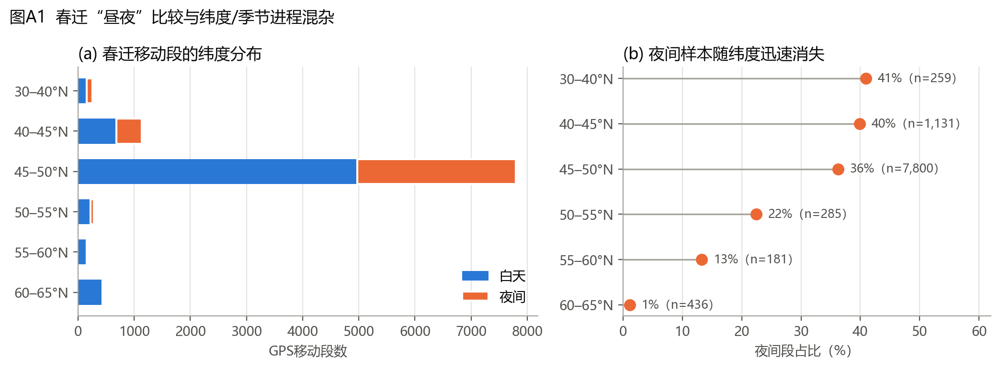
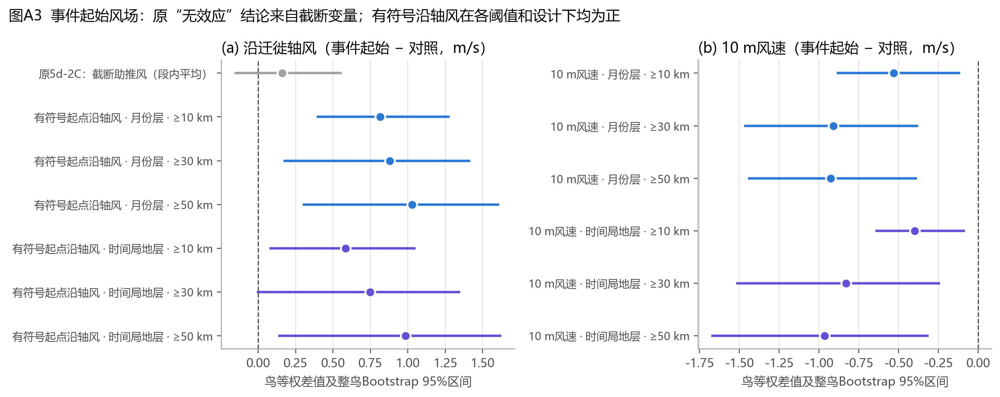
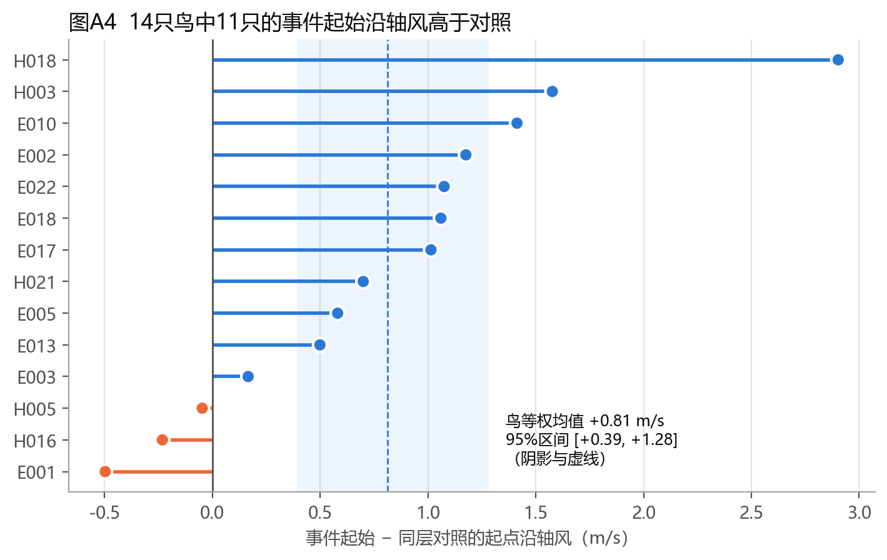
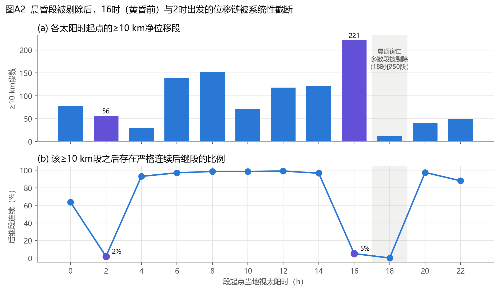
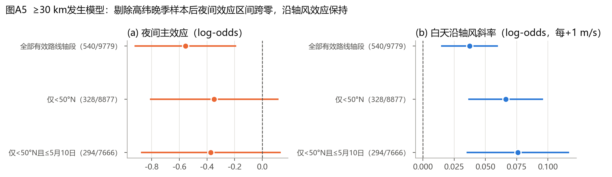

# 白额雁春迁昼夜移动策略与风场响应：项目理解、独立数据审计与SCI可行性评估

**报告日期：** 2026年11月9日
**审阅范围：** `GWFG_Spring_DayNight_Wind_StageReport_Package` 全部73个文件（冻结数据、ERA5匹配表、风场重构、事件表、模型输出、代码、5份审计报告、16张图、清单与源归档）及阶段进展报告（Markdown/Word）
**审阅方式：** 逐文件阅读 + 独立复算。复算脚本为 `src/audit/gwfg_independent_audit.py`，全部数值写入 `docs/audit_results.json`，可一键重现。未修改任何冻结输入。

---

## 执行摘要

**总体判断：项目有条件可行，科学价值中等偏上，但目前尚不具备投稿条件。** 数据链条（GPS冻结 → ERA5匹配 → 风场重构 → 段尺度模型 → 事件尺度分析）完整、可追溯，审计记录规范，解释边界写得很克制，这是本项目最大的优点。

独立复算发现三个会改变结论的问题：

1. **Phase 5d-2C“事件起始助推风无效应”的结论是变量选择造成的。** 原分析比较的是被截断为非负值的段内平均助推风（`SpringRoute_Tailwind_mps`，负值一律记为0），而不是报告所述的起点有符号沿轴风。改用有符号起点沿轴风后，事件起始时的沿轴风比同层对照高 **+0.81 m/s（鸟等权95%区间 [+0.39, +1.28]，14只鸟中11只为正）**；在更严格的“同鸟、±3天、同太阳时±1 h”时间局地对照下仍为 **+0.58 m/s [+0.07, +1.05]**；效应随事件距离阈值增大而增强（条件Logit每m/s的OR：≥10 km 1.08，≥30 km 1.19，≥50 km 1.24）。原结果（+0.158 [−0.158, +0.557]）已被精确复现，证明差异确实来自变量口径。
2. **晨昏段剔除系统性截断了黄昏前后的出发过程。** 太阳时16时是≥10 km净位移段最多的时刻（221段，占全部1,174段的18.8%），但其中只有5%拥有严格连续的后继段，因为18时前后的晨昏段被排除在冻结样本之外。因此“≥2段持续事件”的定义几乎不可能包含黄昏出发，“白天159条/夜间65条”的事件昼夜构成在相当程度上是采样结构的产物。
3. **春迁“昼夜差异”与纬度和季节进程混杂。** 夜间段占比从30–45°N的约40%降到60–65°N的1%（高纬晚春几乎没有真夜）。把样本限制在50°N以南后，≥30 km发生模型中的夜间主效应从 −0.56 [−0.92, −0.19] 变为 −0.35 [−0.81, +0.12]，区间跨零；沿轴风效应则保持并略增。

综合来看，本项目最有希望的论文故事不是“顺风飞得更远”，而是：**春迁出发决策对风的选择性存在昼夜不对称——夜间启动的持续移动更依赖沿迁徙方向的风支持，且出发时偏好“有助推但风速较低”的天气窗口。** 这一判断目前仍是探索性的，需要用全日连续轨迹、飞行高度风场和时间分层病例交叉设计加以确认（见第九、十节）。

---

## 一、项目概况与研究主线

### 1.1 研究对象与数据来源

| 项目 | 内容 |
|---|---|
| 物种 | 白额雁 *Anser albifrons*（Greater White-fronted Goose） |
| 原始数据 | `2015 Tsinghua waterfowl (Yangtze).csv`，59,608行，其中白额雁53,700行、21只个体（数据包未包含原件，仅有SHA-256记录） |
| 时间跨度 | 2015-04-01 至 2019-02-10（UTC） |
| 越冬地 | 鄱阳湖区域（越冬段纬度中位数29.13°N、经度116.17°E） |
| 春迁走廊 | 当地太阳历3–6月、32–65°N、100–145°E；主要停歇区位于东北平原（45–50°N，约125°E），终点方向为东西伯利亚（60–65°N，约127°E） |
| 采样 | GPS约2 h一次；春迁段时长1.517–2.467 h，中位2.00 h |
| 气象 | GEE `ECMWF/ERA5/HOURLY`，标称尺度约27.8 km，四邻像元双线性插值+小时间时间插值；变量含10 m U/V、2 m气温、降水 |

**个体结构（影响全部推断的关键事实）：**

- E001–E005于2015年4月在迁徙途中（37–46°N）开始记录，其2015年春迁轨迹不完整；其余个体于2015年12月在鄱阳湖开始记录。
- H系列（H003–H021）只有2016年一个春季，且轨迹在2016年5月8–18日、43–53°N即结束，没有到达繁殖地。
- 春迁共26个鸟×年份；路线轴有效的为25个鸟×年份、14只鸟（H006全程净位移仅约137 km被排除）。
- 越冬期H系列每只鸟仅13–38个合格段，越冬样本实际由E系列主导。

### 1.2 研究主线

阶段报告将科学问题限定为：春迁期白天与夜间的长距离移动表现是否不同；沿季节性迁徙轴的风支持是否与长距离移动的发生和距离相关；这种关联在移动段尺度与持续事件起始尺度上是否一致。总体主线是“越冬与春迁阶段的昼夜移动策略差异”，风场作为调节变量。

---

## 二、数据与处理流程理解

```
原始GPS（59,608行）
  └─ Phase 5a：质控、太阳高度昼夜分类、阶段划分、冻结 → 17,784段（晨昏段剔除）
       └─ Phase 5c：GEE-ERA5逐段匹配（起点/中点/终点）→ 17,784段全部matched
            ├─ Phase 5d-1：春迁移动状态与候选停歇审计（引入4X辅助晨昏轨迹作连续性证据）
            ├─ Phase 5d-2：阶段×昼夜净位移率模型（12个候选模型，诊断均未通过）
            └─ Phase 5d-2A：H1/H2/H3局地方向与春迁路线轴LOO → 相对风场
                 ├─ Phase 5d-2B：段尺度两部分模型（≥30 km发生 + 条件距离）
                 └─ Phase 5d-2C：≥10 km连续串 → 224条持续候选事件 → 起始风场匹配比较
```

| 阶段 | 核心输出 | 原结论 | 本次复核 |
|---|---|---|---|
| 5a | 17,784段冻结样本 | 行数、ID、哈希通过 | 复核通过 |
| 5c | 逐段ERA5匹配 | 17,784/17,784 matched | 复核通过；3,797段降水为负值（ERA5累积量伪影）仅加标记未截断 |
| 5d-1 | 状态标签、候选停歇 | 连续长距过程存在；严格口径≥24 h停歇为0，辅助口径25段/5鸟 | 认同；严格口径为0是晨昏剔除造成 |
| 5d-2 | 阶段×昼夜模型 | 阶段内夜<昼稳定；差中差不稳健 | 认同 |
| 5d-2A | 路线轴与相对风 | 路线轴覆盖96.9% | 覆盖属实；但“LOO”在每个鸟×年份内最多只有3个不同取值，沿轴风与V10相关0.989（见4.4） |
| 5d-2B | 段尺度模型 | 助推风与≥30 km发生和距离正相关；残差一阶相关0.582 | 系数精确复现 |
| 5d-2C | 事件起始比较 | 助推风差 +0.158，区间跨零 | 精确复现，但该变量为截断段内平均风；有符号起点风结论相反（见4.1） |

---

## 三、数据审计结果

### 3.1 完整性核验（全部通过）

- Phase 5a、5c、5d-2A均为17,784行，`Segment_ID`唯一，三表ID集合完全一致；SHA-256与清单一致。
- 5c中GEE匹配状态17,784/17,784为matched；ERA5产品、空间方法、时间插值字段齐全。
- 5d-2B主模型系数（夜间 −0.5557、沿轴风 +0.0373、侧风 −0.1367、交互 +0.0658）被逐位复现。
- 5d-2C的224条持续事件、218条有效起始段、92个匹配层、6,976个对照段被独立重建并完全一致。

### 3.2 样本结构

| 纬度带 | 段数 | 白天 | 夜间 | 夜间占比 | 鸟数 | 日序中位数 |
|---|---:|---:|---:|---:|---:|---:|
| 30–40°N | 259 | 153 | 106 | 41% | 10 | 99（4月9日） |
| 40–45°N | 1,131 | 680 | 451 | 40% | 12 | 95 |
| 45–50°N | 7,800 | 4,975 | 2,825 | 36% | 15 | 115（4月25日） |
| 50–55°N | 285 | 221 | 64 | 22% | 11 | 141 |
| 55–60°N | 181 | 157 | 24 | 13% | 9 | 144 |
| 60–65°N | 436 | 431 | 5 | 1% | 9 | 143（5月23日） |

77%的春迁段位于45–50°N停歇区，春迁“阶段”主体是停歇期行为而非迁飞本身。



### 3.3 未纳入数据包的关键源文件

- 原始GPS文件`2015 Tsinghua waterfowl (Yangtze).csv`；
- 4X辅助晨昏/边界轨迹原件（Phase 5d-1曾使用）；
- Phase 5a、5c（GEE提取）、5d-1、5d-2A、5d-2C的处理脚本（数据包只有5d-2B脚本，且路径硬编码为`/mnt/data`）。

这意味着目前只有5d-2B可以从数据包直接重跑，其余阶段只能核对输出、不能重放流程。

---

## 四、关键问题清单（按影响程度排序）

### 4.1 【高】事件起始风场结论来自截断变量

- 5d-2C比较的`SpringRoute_Tailwind_mps`来自5d-2A文件，其定义为 max(段内Simpson平均风的沿轴分量, 0)。复算确认其与“截断的Simpson平均沿轴风”逐行一致（最大差7.9×10⁻¹⁴），与“起点风”最大差1.96 m/s。
- 5d-2C报告声明“使用GPS段起点ERA5 10 m U/V”，与实际使用的变量不符。
- 截断把所有逆风记录压成0，丢掉了逆风侧的信息，严重稀释了差异。使用有符号变量后：

| 设计 | 阈值 | 事件/对照 | 沿轴风差（m/s） | 95%区间 | 正向鸟数 |
|---|---|---|---:|---|---:|
| 原5d-2C（截断、段内平均） | ≥10 km | 218 / 6,976 | +0.158 | [−0.158, +0.557] | — |
| 有符号段内平均风 | ≥10 km | 218 / 6,976 | +0.809 | [+0.441, +1.228] | — |
| 有符号起点风，月份层 | ≥10 km | 218 / 6,976 | +0.813 | [+0.391, +1.281] | 11/14 |
| 有符号起点风，月份层 | ≥30 km | 121 / 5,455 | +0.881 | [+0.169, +1.419] | 13/14 |
| 有符号起点风，月份层 | ≥50 km | 100 / 5,118 | +1.028 | [+0.296, +1.610] | 13/14 |
| 有符号起点风，时间局地层 | ≥10 km | 214 / 788 | +0.583 | [+0.074, +1.053] | 11/14 |
| 有符号起点风，时间局地层 | ≥30 km | 120 / 433 | +0.749 | [−0.011, +1.351] | 11/14 |
| 有符号起点风，时间局地层 | ≥50 km | 99 / 348 | +0.983 | [+0.133, +1.626] | 11/14 |

*时间局地层：同鸟同春迁年份、与事件起点相差≤3天、当地视太阳时相差≤1 h、净位移<10 km的段作为对照。区间为整鸟Bootstrap（5,000次）。*





### 4.2 【高】晨昏剔除造成的结构性截断

| 起点太阳时 | 全部段 | ≥10 km段 | ≥10 km段有严格连续后继段的比例 |
|---:|---:|---:|---:|
| 0 | 929 | 77 | 64% |
| 2 | 483 | 56 | 2% |
| 6 | 959 | 139 | 97% |
| 8 | 976 | 152 | 99% |
| 14 | 979 | 121 | 97% |
| **16** | **978** | **221** | **5%** |
| 18 | 50 | 12 | 0% |
| 20 | 889 | 41 | 98% |

后果：

1. 黄昏前后出发的持续移动几乎不可能被识别为“≥2段持续事件”，而这恰恰可能是雁类夜间迁飞最典型的出发时刻。
2. “夜间事件”只能从20时之后开始、在4时前后被截断：65条夜间起始事件最长只有4段（8.0 h），159条白天起始事件最长8段（16 h）；**224条事件中没有一条跨越昼夜**。而5d-1的辅助轨迹显示有40条长距链同时包含白天和夜间段。严格口径最长连续链只有18 h，辅助轨迹口径可达718 h。
3. 事件的昼夜构成（159 vs 65）和“白天事件更多”的描述，主要反映的是采样结构，而不是行为。
4. 与之对应，严格口径≥24 h停歇为0也是同一原因（5d-1已指出）。



### 4.3 【高】昼夜比较与纬度、季节进程混杂

- 高纬晚春夜短甚至无真夜，夜间样本集中在低纬、早期停歇区，白天样本则额外包含高纬、晚季、到达期行为。
- 太阳高度标签本身是正确的，但“夜间”与“地点+日期”高度共线，段级昼夜对比不能直接解释为昼夜策略差异。

| 子样本 | ≥30 km/总段 | 夜间主效应 [95%区间] | 白天沿轴风斜率 [95%区间] |
|---|---|---|---|
| 全部有效路线轴段 | 540 / 9,779 | −0.556 [−0.924, −0.188] | +0.037 [+0.015, +0.060] |
| 仅<50°N | 328 / 8,877 | −0.348 [−0.813, +0.117] | +0.066 [+0.036, +0.096] |
| 仅<50°N且≤5月10日 | 294 / 7,666 | −0.372 [−0.878, +0.133] | +0.076 [+0.035, +0.117] |



### 4.4 【中】“沿迁徙轴风”实际上约等于南风分量

- 25条有效路线轴方位全部落在 −6.4° 至 +23.3°（近正北），沿轴风与V10相关系数 **0.989**。
- “LOO路线轴”只排除当前段的两个端点，而路线轴由剩余事件中最早与最晚的位置决定，所以除首末段外，LOO轴与全程轴完全相同（每个鸟×年份最多3个不同取值）。“LOO”这一名称夸大了它的独立性。
- 在鸟×年份内，沿轴风与2 m气温的相关为0.26（南风带来暖平流）。加入气温距平后沿轴风效应仍然存在（β=0.072 [0.041, 0.102]），但天气系统层面的混杂（锋面、气压型）尚未排除。
- 论文中应直接称为“偏南风支持（southerly wind support）”，并说明它与路线轴投影几乎等价。

### 4.5 【中】风暴露口径不一致

- 5d-2A文件中所有`SpringRoute_*`变量基于段内Simpson平均风，包含终点风。终点风取决于鸟最终到达哪里，对长距离段是内生的。
- 5d-2B在脚本中重新计算了起点风，因此主模型是干净的；但5d-2C直接用了5d-2A的Simpson变量。
- 同一份阶段报告中，3.2节（助推风302段/阻碍风238段，中位距离105.69 vs 83.69 km）来自Simpson口径；3.3节表格（白天助推201/阻碍199，夜间101/39）来自起点口径。540段中有48段的助推/阻碍符号在两种口径间不一致。

### 4.6 【中】春迁阶段边界

- 春迁窗口包含5月下旬至6月60–65°N的到达后/繁殖前行为，65°N截断又切掉了最后一段迁飞。
- E001–E005的2015年轨迹从途中开始，H系列在中途结束，各鸟×年份对应的迁徙“阶段”并不对等。

### 4.7 【中】时间依赖与小样本推断

- 段尺度二项模型残差一阶相关0.582；14个鸟簇的稳健标准误只是近似。
- 留一鸟预测几乎没有改进（LogLoss 0.2133 → 0.2123，Brier 0.05290 → 0.05286）：风变量具有关联性，但个体外推能力弱。
- 阶段比较的12个候选模型诊断均未通过，Student-t自由度约2.05，触及边界。

### 4.8 【低-中】可复现性

- 只有5d-2B脚本，路径硬编码为`/mnt/data`；没有环境文件；5a/5c/5d-1/5d-2A/5d-2C的处理代码缺失。
- 原始GPS与4X辅助轨迹不在包内，事件重定义（第九节P1）目前无法进行。

### 4.9 【低】其他

- 10 m风不等于飞行高度风（报告已说明）。
- 3,797段降水为负值，应在使用前截断为0。

---

## 五、研究现状总结

| 维度 | 状态 |
|---|---|
| 数据冻结与匹配 | 完成，质量高，可追溯 |
| 昼夜分类 | 完成；太阳高度规则合理，但剔除晨昏导致连续性断裂 |
| 方向参照 | 完成；局地方向覆盖不足，路线轴可用但本质为南风分量 |
| 段尺度风场关联 | 完成探索性模型；正向关联稳健，时间依赖未处理 |
| 事件尺度 | 事件识别方法可用；起始风场结论需按4.1更正 |
| 停歇识别 | 候选阶段；严格口径不可用，辅助口径仅5只鸟 |
| 移动状态模型（HMM） | 未开始；全日连续轨迹条件已具备（辅助轨迹12,722段、185条链） |
| 阶段×昼夜比较 | 描述性方向一致，确认性模型未通过诊断 |
| 飞行高度/飞行确认 | 未开展；数据中已有设备瞬时地速和GPS高度（见9.5） |
| 论文写作 | 尚未开始；已有阶段报告可作方法部分底稿 |

---

## 六、目前能够支持的科学结论

按证据强度分级：**A=稳健描述性结论；B=多口径一致的探索性关联；C=提示性线索。**

1. **（A）** 春迁期白天GPS净位移明显大于夜间：白天≥10 km段占13.9%，夜间7.3%；白天<500 m段51.5%，夜间75.1%。越冬期同样是夜间净位移率低于白天（中位0.022 vs 0.113 km/h）。方向在各口径一致，但大小受纬度混杂影响（4.3）。
2. **（A）** 夜间长距离移动客观存在且跨个体重复：夜间≥50 km段106个、来自11只鸟；剔除贡献最大的E010后仍有85段、10只鸟。白额雁春迁并非“只在白天飞”。
3. **（A）** 个体异质性明显：15只鸟中4只的夜间≥10 km比例高于白天，11只相反。
4. **（B）** 段尺度：偏南（沿迁徙轴）风越强，出现≥30 km净位移的概率越高、条件距离越大。效应在留一鸟（斜率0.033–0.045）、加入纬度、加入气温、改用段内平均风、改用50 km阈值后均保持。效应量不大：白天每+1 m/s的OR为1.04，夜间约1.11。
5. **（B，更正后）** 事件尺度：持续长距离移动启动时的沿轴风高于同鸟同期对照，且阈值越高效应越大，在时间局地对照下依然成立（4.1）。
6. **（B）** 事件启动时10 m风速较低：月份层 −0.53 m/s [−0.89, −0.11]，时间局地层 −0.40 m/s [−0.65, −0.08]，30/50 km阈值下差异更大（约 −0.8至−1.0 m/s）。与“有助推但不强”的出发窗口一致。
7. **（C）** 夜间启动事件的风选择性可能更强：时间局地层条件Logit中，沿轴风×夜间交互为 +0.160（模型SE 0.068），白天斜率 +0.036（SE 0.034）。该SE未按鸟聚类，只作线索。
8. **（C）** 原月份层中“事件起始气温更低”（−1.2 °C）在时间局地层中消失（+0.36 °C，区间跨零），说明它是日内时刻差异的产物，不应作为结论。

**目前不能支持：** 风“导致”出发或迁飞（因果）；飞行高度上的顺/逆风效应；阶段×昼夜差中差是普遍策略；候选停歇是确认的迁徙停歇地；任何HMM行为状态。

---

## 七、尚未解决的问题

1. **出发事件的真实定义。** 严格样本中黄昏出发被截断，224条事件不是完整清单；需要全日连续轨迹重新识别“停歇→出发→持续移动→降落”。
2. **飞行确认。** 2 h端点净位移不等于飞行。设备瞬时地速（≥5 m/s的定位点609个、8只鸟）尚未被利用。
3. **飞行高度风场。** 10 m风与雁类飞行高度（通常数百米至千余米）的风可能差异很大，尤其在夜间稳定边界层条件下。
4. **混杂控制。** 纬度/日期、日内时刻、天气系统（气压变化、锋面、降水、云量）、停歇时长和能量状态尚未纳入同一模型。
5. **时间依赖。** 段尺度模型残差相关0.58；需要事件级或状态空间模型。
6. **独立样本量。** 只有14只鸟提供有效风场，H系列只有一个不完整春季；鸟×年份之间的重复测量结构需要显式建模。
7. **阶段比较。** 越冬没有迁徙轴，阶段×昼夜差中差在鸟等权口径下跨零；越冬期需要单独的生态学问题（觅食地—夜栖地往返）。
8. **停歇识别。** 候选停歇只有5只鸟，阈值敏感性大。
9. **数据权属与已有成果。** 数据来自清华大学水鸟追踪项目，需确认使用授权，并检索同一数据集已发表的研究，避免重复。

---

## 八、现有研究的创新潜力

**创新点需要诚实分级。** “顺风有利于迁飞/顺风时出发”是迁徙生态学的成熟结论，单独报告不构成创新。真正有潜力的方向如下：

| 潜在创新点 | 现有证据 | 潜力评估 |
|---|---|---|
| **出发风选择性的昼夜不对称**：夜间启动的持续移动更依赖风支持 | 6.7（C级线索）；夜间段尺度斜率点估计也更大 | **高**。若在全日轨迹和飞行高度风下成立，可直接回答“风是否改变昼夜移动策略”，与项目主线一致 |
| **“助推但温和”的出发天气窗口**：高沿轴风 + 低风速 | 6.5、6.6（B级） | **中高**。可延伸为天气系统尺度（高压后部、气压回升）的出发规则 |
| **风对“移动表现”与“出发决策”的多尺度分解** | 段尺度与事件尺度结果均为正，效应随事件阈值增大 | **中**。方法框架清晰，适合Movement Ecology类期刊 |
| **东亚迁徙路线、鄱阳湖—东北平原—东西伯利亚种群** | 数据本身 | **中**。欧洲白额雁研究较多，东亚种群的出发决策研究相对少；需文献检索确认 |
| **方法学警示**：晨昏剔除与截断风变量如何扭曲推断 | 4.1、4.2 | **中**。可作为方法部分或补充材料的重要内容，提高论文可信度 |
| 停歇—迁飞转换的昼夜节律 | 5d-1候选停歇（5只鸟） | 低到中。样本不足，需全日轨迹重建 |

**建议的论文定位：** 以“春迁出发时机与风选择的昼夜差异”为核心问题，越冬期昼夜节律作为基线背景（证明昼夜差异不仅是迁徙特有），风场作为检验昼夜策略的环境调节变量。这与阶段报告“风服务于昼夜策略主线”的原则一致，同时把最有力的结果放在中心位置。

---

## 九、下一步最值得开展的分析

按投入产出比排序：

### P0（1周内）：修正与统一口径

1. 用有符号起点沿轴风重做5d-2C全部表格与图件；保留截断变量结果作为对比，写明差异原因。
2. 全项目统一风暴露为起点（或出发前1 h）风；Simpson平均风只作敏感性分析。
3. 将“沿迁徙轴风”改称“偏南风支持”，在方法中说明其与V10的等价性；“LOO”改称“鸟×年份季节路线轴”。
4. 降水负值截断为0；补齐各阶段脚本并改为相对路径。

### P1（关键，2–4周）：基于全日连续轨迹重建出发事件

1. 取回原始GPS与4X辅助晨昏轨迹，保留晨昏段，构建不中断的2 h轨迹。
2. 用连续太阳高度（或“相对日落时间”）代替昼夜二分类描述出发时刻。
3. 识别“停歇段 → 出发 → 持续移动 → 降落”，出发定义为停歇后首个≥10/30/50 km段的起点；用设备瞬时地速≥5 m/s辅助确认飞行。
4. 报告每只鸟的出发次数、出发时刻分布（是否集中在黄昏）和停歇时长。

### P2（核心检验，2–3周）：时间分层病例交叉设计（time-stratified case-crossover）

- **病例：** 每次出发的出发时刻、出发地点的气象条件。
- **对照：** 同一停歇地点、同一停歇期内其他日期的同一太阳时（例如±1 h）——ERA5可以提取任意时刻，不需要GPS对照段，从而彻底消除地点、季节和日内时刻混杂。
- **暴露：** 1000/925/850 hPa的U/V（按Safi等2013的风支持公式计算）、风速、气压24 h变化、气温变化、降水、云量。
- **模型：** 条件Logit，按鸟聚类或整鸟Bootstrap；风支持×出发时刻（昼/夜/晨昏）交互是核心检验。

### P3：离散时间风险模型（出发决策）

以停歇期内每个2 h时步为单位，响应为“是否出发”，协变量包括停歇已持续时间、日期、光周期、太阳高度、风支持、天气变化，鸟与鸟×年份随机效应（GLMM/GAMM）。这是回答“什么条件下结束停歇”的标准框架。

### P4：移动状态模型（HMM）

用全日连续轨迹拟合2–3状态HMM（如momentuHMM），把太阳高度、阶段和风支持作为状态转移概率的协变量，比较越冬与春迁的昼夜状态转换差异。这是把“阶段×昼夜策略”主线做实的最佳工具，同时天然处理时间依赖。

### P5：飞行高度与飞行确认

利用`End_Device_Ground_Speed_mps`和`End_Height_Above_Ellipsoid_m`：识别飞行中定位点（≥5 m/s），结合大地水准面与DEM换算离地高度（飞行点椭球高中位305 m，静止点234 m，需校正），再匹配对应气压层的风。可回答“夜间是否飞得更高、是否选择风支持最好的高度层”。

### P6：稳健性与功效

整鸟留一、鸟×年份Bootstrap、阈值（10/30/50 km）与对照窗口（±2/3/5天）敏感性、预先登记的分析计划；对14只鸟能检测到的最小效应做模拟功效分析。

---

## 十、目前距离高质量SCI论文还缺少什么

| 缺口 | 当前状态 | 需要达到的标准 | 优先级 |
|---|---|---|---|
| **1. 核心结论正确性** | 5d-2C事件结论方向有误 | 用有符号起点风更正并公开对比 | 必须 |
| **2. 事件定义无结构性偏差** | 晨昏剔除截断黄昏出发 | 基于全日连续轨迹重建出发事件 | 必须 |
| **3. 混杂控制** | 昼夜与纬度/日期共线；月份层对照过粗 | 病例交叉或离散时间风险模型，同地点同时刻对照 | 必须 |
| **4. 时间依赖处理** | 残差相关0.58，聚类SE近似 | 事件级模型或HMM，显式建模状态持续性 | 必须 |
| **5. 飞行高度风场** | 仅10 m风 | 至少925/850 hPa风支持，或基于GPS高度选择层次 | 强烈建议 |
| **6. 飞行确认** | 2 h净位移推断 | 用瞬时地速确认飞行定位点 | 强烈建议 |
| **7. 清晰的单一科学问题** | 主线在“阶段×昼夜”和“风”之间摇摆 | 一句话问题 + 2–3个可证伪预测 | 必须 |
| **8. 文献定位** | 参考文献5篇 | 系统综述雁类出发决策、风选择、昼夜迁飞（含东亚研究和同一数据集已有论文），明确空白 | 必须 |
| **9. 样本量说明** | 14只有效鸟 | 以鸟为单位报告所有效应、个体图、功效分析，避免以段数夸大样本 | 必须 |
| **10. 可复现性** | 仅部分脚本，路径硬编码 | 完整代码仓库（本仓库已搭建框架）、环境文件、数据可得性声明（Movebank DOI或申请途径） | 必须（多数期刊要求） |
| **11. 图件质量** | 默认样式、无不确定性带 | 出版级多面板图：迁徙路线图、出发时刻分布、风支持效应曲线及区间、个体效应图 | 建议 |
| **12. 伦理与数据权属** | 未说明 | 标记许可、动物伦理批文、数据使用授权与作者贡献 | 必须 |

**期刊匹配建议（完成P0–P3后）：** *Movement Ecology*、*Avian Research*、*Journal of Avian Biology*、*Ecology and Evolution*、*Ibis*。若P4–P5同时完成并得到清晰的昼夜不对称结果，可考虑冲击 *Journal of Animal Ecology* 或 *Proceedings of the Royal Society B*，但需要更强的机制证据。

**时间估算：** 在能取回原始GPS与4X辅助轨迹的前提下，P0–P3约6–8周可形成投稿初稿；加上P4–P5约需3个月。

---

## 附录A：复现方式

```bash
python -I src/audit/gwfg_independent_audit.py --package "<阶段数据包路径>" --out docs
```

脚本只读取冻结数据，输出`docs/audit_results.json`与`docs/figures/A1–A5`。依赖见`requirements.txt`。

## 附录B：本报告引用的阶段文件

- 阶段报告：`docs/stage_report/`
- 原审计报告：`docs/audit_reports/`
- 原模型输出：`results/`
- 原图件：`figures/original/`
- 原脚本：`src/legacy/`

## 附录C：建议补充检索的文献方向

1. 雁类迁徙出发决策与天气（含Kölzsch等2016，*Oikos*，已在阶段报告中引用）；
2. 风支持的计算尺度与方法（如Safi等2013，*Movement Ecology*）；
3. 移动状态模型方法（moveHMM、momentuHMM）；
4. 东亚迁徙路线白额雁卫星/GPS追踪研究，以及清华大学水鸟追踪项目已发表的论文（避免与已有成果重复，并核实数据使用授权）。

以上文献信息需在写作前逐条核实。
